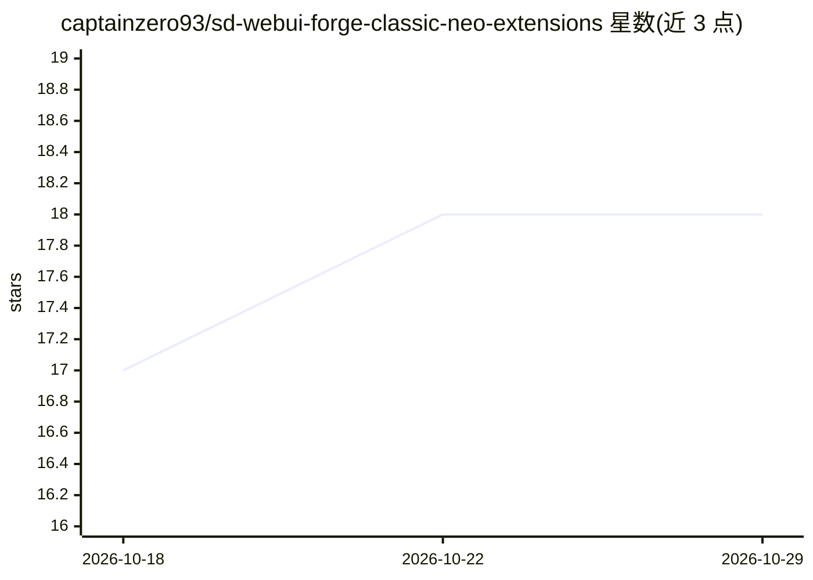

# captainzero93/sd-webui-forge-classic-neo-extensions

⭐ 18 · Python · 推送 2026-06-05 · [GitHub](https://github.com/captainzero93/sd-webui-forge-classic-neo-extensions) · 个人维护

**为 Forge Neo 更新的缺失 SD WebUI 扩展集合（FreeU/PAG/SAG 等）**

面向 SD WebUI Forge Classic Neo 分支用户的扩展仓库：收录并更新原 Forge 中缺失的扩展，包括 FreeU (v2)、Perturbed Attention、SAG（Self-Attention Guidance）以及 UDDetailer 安装说明（指向 ADetailer-Neo 替代 ADetailer）。安装方式为克隆或下载仓库后，将各扩展文件夹复制到 Forge Neo 的 extensions 目录并重启。各扩展许可证各自独立。

## 筛选速览

| 维度 | 判定 | 备注 |
|---|---|---|
| AI 角色 | `ai-ecosystem` | LLM/agent 周边工具 |
| 许可风险 | `none` | — |
| 部署形态 | `None` |  |
| 模型依赖 | — | README 未给出锁定关系 |
| 硬件要求 | — | 无带数字的原话,不猜 |
| 安装摩擦 | `low` | 无编译、无系统依赖或容器化 |
| 成熟度 | — | 结构信号不足 |

## 能力要点

- FreeU (v2)、Perturbed Attention、SAG 三个更新扩展
- UDDetailer（ADetailer 替代）安装说明与修复
- 手动复制到 extensions 目录的安装流程

## 适用场景

- 在 Forge Neo 中恢复 FreeU/PAG/SAG 等采样引导功能
- 用 UDDetailer/ADetailer-Neo 实现自动脸部/手部修复

## 场景标签

`图像生成` · 领域:内容生成

## 证据(README 行号)

> L5: This repository contains missing extensions from Webui Forge - Neo that have been updated.
> L10: - **FreeU (v2)** - FreeU extension for Forge Neo

## 星数曲线

2026-10-18 17 → 2026-10-29 18（+1）

---
*卡片 v1 · prompt 1.4 · 生成 2026-10-29 · 置信度 high · 依据 README sha `72cbfc0d112d` · [字段定义](../../DATASET.md)*
