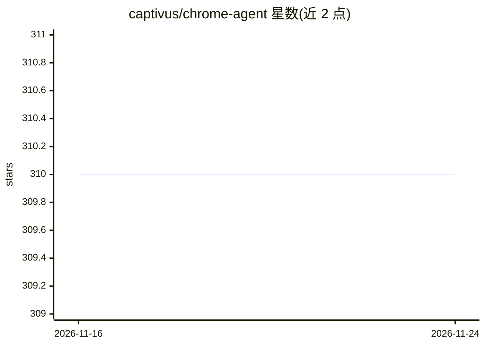

# captivus/chrome-agent

⭐ 310 · Python · MIT · 推送 2026-11-23 · [GitHub](https://github.com/captivus/chrome-agent) · [官网](https://pypi.org/project/chrome-agent/) · 个人维护

**让 AI 编码 Agent 直接通过 CDP 观察和操作 Chrome 的 CLI**

面向 AI 编码 Agent 的命令行工具：通过 Chrome DevTools Protocol 直连浏览器，不做抽象封装，Agent 可调用 Chrome 支持的任意 CDP 命令、事件与域。多个 Agent 和人可共享同一浏览器，各自拥有隔离的事件订阅；提供一次性命令模式（约 50-80ms）与持久 attach 模式两种通道。附带实例管理（launch/status/stop）、glob 实例匹配、zsh 补全、会话快照 save/restore 等运维命令。要求系统已装 Chrome/Chromium，运行时依赖为 websockets、cryptography、keyring，不下载浏览器、不依赖 Playwright。

## 筛选速览

| 维度 | 判定 | 备注 |
|---|---|---|
| AI 角色 | `ai-ecosystem` | LLM/agent 周边工具 |
| 许可风险 | `permissive` | MIT |
| 部署形态 | `library` | 以包/库形式分发 |
| 模型依赖 | — | README 未给出锁定关系 |
| 硬件要求 | — | 无带数字的原话,不猜 |
| 安装摩擦 | `low` | 无编译、无系统依赖或容器化 |
| 成熟度 | — | 结构信号不足 |

## 能力要点

- 无抽象层直连 CDP，任意命令/事件/域随 Chrome 版本即装即用
- 多 Agent 与人共享同一浏览器，事件订阅相互隔离
- 一次性命令 + 持久 attach 两种交互通道
- 实例快照保存/恢复（save/restore）与 zsh 补全

## 适用场景

- 让编码 Agent 在真实 Chrome 中测试与调试自己的代码
- 一个 Agent 驱动浏览器、另一个观察网络流量的协同调试
- 多 Agent 对单一浏览器运行协调的测试套件

## 场景标签

`浏览器自动化` · 领域:效率与自动化

## 证据(README 行号)

> L8: A CLI tool that gives AI coding agents the ability to observe and interact with Chrome browsers via the Chrome DevTo
> L48: AI coding agents need to see and interact with browsers -- to test their code, debug automation, inspect page state

## 星数曲线

2026-11-16 310 → 2026-11-24 310（+0）

---
*卡片 v1 · prompt 1.4 · 生成 2026-11-17 · 置信度 high · 依据 README sha `30a69b9abb49` · [字段定义](../../DATASET.md)*
