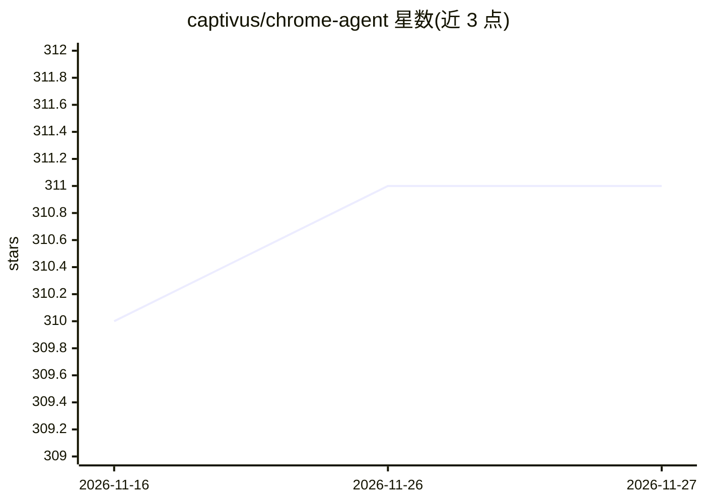

# captivus/chrome-agent

⭐ 311 · Python · MIT · 推送 2026-11-23 · [GitHub](https://github.com/captivus/chrome-agent) · [官网](https://pypi.org/project/chrome-agent/) · 个人维护

**让 AI 编码代理通过 CDP 直接操作 Chrome 的 CLI**

chrome-agent 是一个 CLI 工具，为 AI 编码代理提供对 Chrome DevTools Protocol 的直接访问：发送任意 CDP 命令、订阅事件流，不做协议子集封装，命令可用性跟随本机 Chrome 版本。支持多个代理与人类共享同一浏览器实例，各自拥有隔离的事件订阅。提供一次性命令与 attach 持久事件两种通道、实例注册表与 glob 匹配、会话保存/恢复、zsh 补全。通过 uv 安装，运行依赖 Chrome/Chromium 与 websockets 等库。

## 筛选速览

| 维度 | 判定 | 备注 |
|---|---|---|
| AI 角色 | `ai-ecosystem` | LLM/agent 周边工具 |
| 许可风险 | `permissive` | MIT |
| 部署形态 | `library` | 以包/库形式分发 |
| 模型依赖 | — | README 未给出锁定关系 |
| 硬件要求 | — | 无带数字的原话,不猜 |
| 安装摩擦 | `low` | 无编译、无系统依赖或容器化 |
| 成熟度 | — | 结构信号不足 |

## 能力要点

- 完整 CDP 协议直通：任意命令/事件/域随所装 Chrome 支持
- 多代理与人类共享同一浏览器，事件订阅相互隔离
- 一次性命令（~50-80ms）与 attach 持久事件流两种通道
- 实例管理：glob 批量操作、会话 save/restore、孤儿清理

## 适用场景

- 让编码代理测试自己写的网页代码并检查页面状态
- 代理运行时旁观者监控网络流量或页面错误
- 多个代理对同一浏览器协同执行测试套件
- 保存并恢复带 cookie 与登录态的浏览器会话

## 场景标签

`浏览器自动化` · 领域:效率与自动化

## 证据(README 行号)

> L8: A CLI tool that gives AI coding agents the ability to observe and interact with Chrome browsers via the Chrome DevTo
> L10: Multiple agents and humans can share the same browser simultaneously, each with isolated event subscriptions. One a
> L48: AI coding agents need to see and interact with browsers -- to test their code, debug automation, inspect page state

## 星数曲线

2026-11-16 310 → 2026-11-27 311（+1）

---
*卡片 v1 · prompt 1.4 · 生成 2026-11-25 · 置信度 high · 依据 README sha `72cab742a08e` · [字段定义](../../DATASET.md)*
