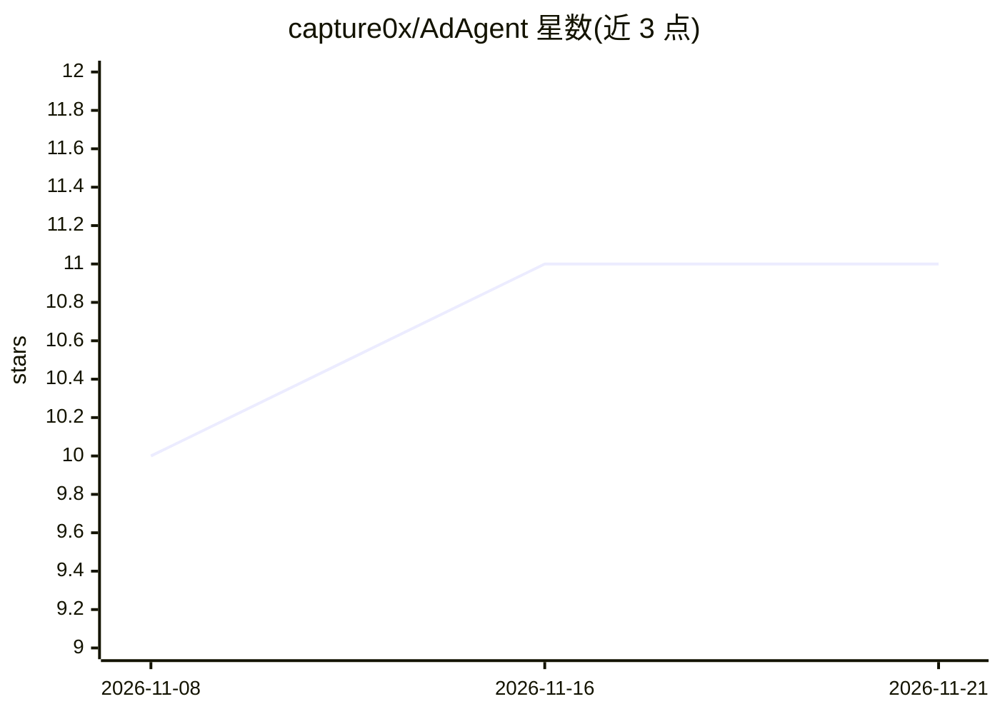

# capture0x/AdAgent

⭐ 11 · Python · MIT · 推送 2026-06-03 · [GitHub](https://github.com/capture0x/AdAgent) · 个人维护

**AI 驱动的 AD 攻防测试 agent，供授权红队自动化执行攻击链**

Standalone 自主 agent，将 59 个 Active Directory 攻击工具按杀伤链串联执行，覆盖侦察、枚举、凭据攻击、提权、横向移动到域控，支持追踪证据、记录死路径并生成结构化渗透报告。提供三种运行模式：本地 Ollama 模型、Anthropic Claude API、或作为 MCP server 由 Claude Code/Cursor 等宿主驱动（无需 API key）。支持密码、NT Hash 传递、Kerberos ccache 三种认证方式与 loud/normal/stealth 三档 OPSEC。仅限书面授权环境使用。

## 筛选速览

| 维度 | 判定 | 备注 |
|---|---|---|
| AI 角色 | `ai-native` | 本体是模型或模型工具 |
| 许可风险 | `permissive` | MIT |
| 部署形态 | `None` |  |
| 模型依赖 | local-ok | 支持本地模型 |
| 硬件要求 | — | 无带数字的原话,不猜 |
| 安装摩擦 | `low` | 无编译、无系统依赖或容器化 |
| 成熟度 | — | 结构信号不足 |

## 能力要点

- 59 个攻击工具与 139 项技术，22 类 YAML 注入 AI 系统提示
- 三种后端：Ollama 本地模型、Claude API、MCP server 接入 Claude Code/Cursor
- chain_planner 按置信度排序攻击路径并生成可执行命令序列
- 自动生成 HTML/Markdown/JSON/ATT&CK Navigator 报告，含 CVSS v3.1 评分

## 适用场景

- 授权红队评估中自动化执行 AD 攻击链
- 渗透测试后生成含 MITRE ATT&CK 映射的结构化报告
- 通过 Claude Code 等宿主以自然语言指挥 AD 攻击工具
- plan 模式下仅生成攻击计划而不执行

## 场景标签

`网络安全` · 领域:学习与行业

## 证据(README 行号)

> L11:  AI-Powered Active Directory Attack Agent
> L19: **AdAgent** is a standalone autonomous agent that chains Active Directory offensive techniques automatically using 

## 星数曲线

2026-11-08 10 → 2026-11-21 11（+1）

---
*卡片 v1 · prompt 1.4 · 生成 2026-11-18 · 置信度 high · 依据 README sha `8ea9813599a5` · [字段定义](../../DATASET.md)*
