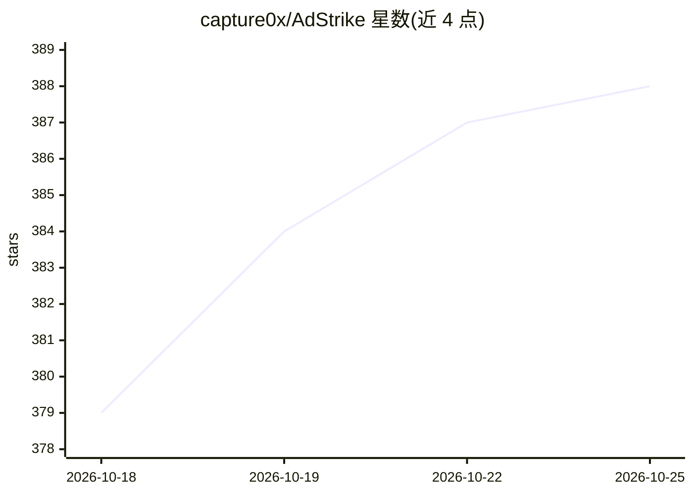

# capture0x/AdStrike

⭐ 388 · Python · MIT · 推送 2026-10-17 · [GitHub](https://github.com/capture0x/AdStrike) · [官网](https://adstrike.oxcapture.com) · 个人维护

**模块化 Active Directory 红队攻击框架，含 AI 助手与 MCP 接入**

面向授权渗透测试人员的终端式 Active Directory 攻击框架，覆盖侦察、枚举、提权、横向移动、凭据获取、持久化、云/混合环境到报告生成的 9 个 kill-chain 阶段，共 52 个攻击模块与 6 个工具，通过共享会话保存目标、凭据与 Kerberos 状态。AI 部分为可选：AdStrike Agent 规划编排、Smart Analyst 解析输出并排序下一步，以及暴露全部 53 个工具的 MCP 服务器，可接入 Claude Code/Cursor/Claude Desktop 由其 LLM 驱动，也可用 ANTHROPIC_API_KEY 作可选后端。当前为 beta/research 版本，依赖 Kali/Parrot 环境下的外部 AD 工具。

## 筛选速览

| 维度 | 判定 | 备注 |
|---|---|---|
| AI 角色 | `ai-enhanced` | 去掉 AI 部分产品仍成立 |
| 许可风险 | `permissive` | MIT |
| 部署形态 | `None` |  |
| 模型依赖 | — | README 未给出锁定关系 |
| 硬件要求 | — | 无带数字的原话,不猜 |
| 安装摩擦 | `medium` | 含编译或系统依赖之一 |
| 成熟度 | `idea` | |

## 能力要点

- 52 个攻击模块按 9 个 kill-chain 阶段组织，含 Kerberos/ADCS 工作流
- MCP 服务器暴露全部 53 个工具，无需 API key，由现有 MCP host 的 LLM 驱动
- Smart Analyst 解析输出并排序后续动作，AdStrike Agent 可选 AI 编排
- 生成 HTML/Markdown/JSON 报告，会话状态跨模块共享

## 适用场景

- 授权红队演练中按阶段执行 AD 枚举与攻击路径分析
- 通过 Claude Code/Cursor 等 MCP host 用自然语言驱动整套测试流程
- NTLM 禁用环境下的 Kerberos 工作流操作
- 整理渗透发现并导出报告

## 场景标签

`网络安全` · 领域:学习与行业

## 证据(README 行号)

> L22: AdStrike is a modular, terminal-based Active Directory attack framework. It helps operators move through discovery,
> L40: - Optional AdStrike Agent for AI-assisted planning or tool orchestration
> L41: - **MCP server exposing all 53 tools — no API key, driven by your existing MCP host (Claude Code / Cursor / Claude 

## 星数曲线

2026-10-18 379 → 2026-10-25 388（+9）

---
*卡片 v1 · prompt 1.4 · 生成 2026-10-21 · 置信度 high · 依据 README sha `b979991ce8bd` · [字段定义](../../DATASET.md)*
