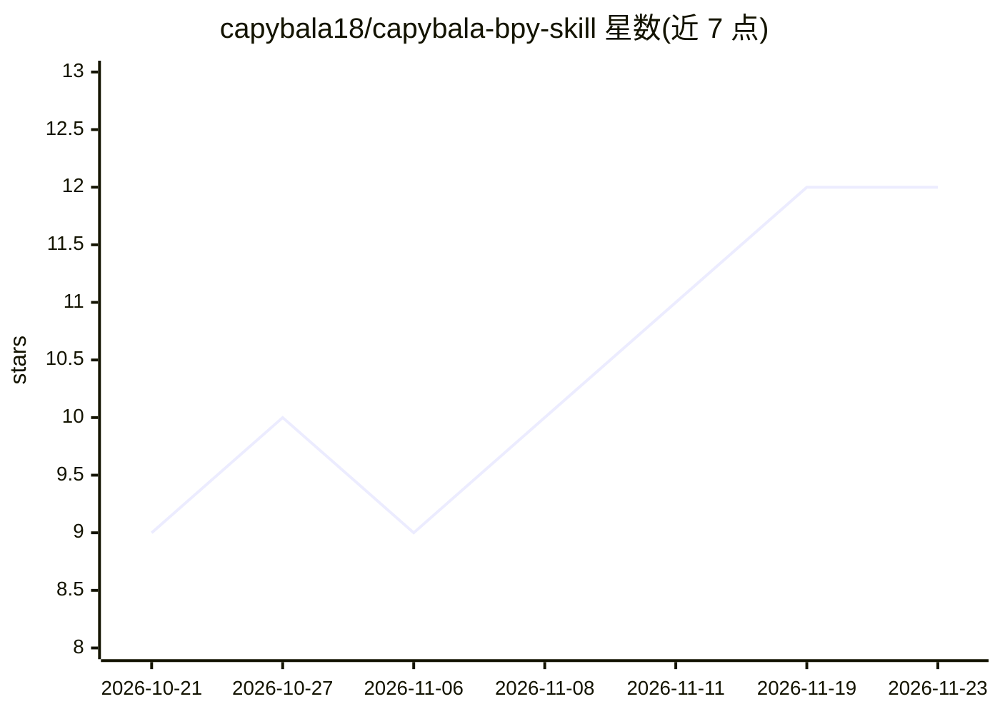

# capybala18/capybala-bpy-skill

⭐ 12 · Python · MIT · 推送 2026-09-16 · [GitHub](https://github.com/capybala18/capybala-bpy-skill) · 个人维护 · 中文 README

**驱动 AI agent 无头操作 Blender 建模渲染的技能文件**

一个面向 AI coding agent 的 SKILL.md 操作手册，配合 bpy Python 库（材质、参数化形状、建筑、地形、测量工具等），指导 agent 以无头模式完成 Blender 的建模、材质、灯光、渲染与导出。核心机制包括 Stage A→B→C 工作流、构建后几何审计（穿插/悬空/间距检测）、数值化曝光校验门控，以及按真实渲染输出校准的相机/灯光预设。要求 Blender 5.1.x；SKILL.md 正文为繁体中文。车辆与人形类别为已知薄弱点。

## 筛选速览

| 维度 | 判定 | 备注 |
|---|---|---|
| AI 角色 | `ai-knowledge` | 知识聚合/清单类 |
| 许可风险 | `permissive` | MIT |
| 部署形态 | `desktop` | 安装包/桌面程序 |
| 模型依赖 | — | README 未给出锁定关系 |
| 硬件要求 | — | 无带数字的原话,不猜 |
| 安装摩擦 | `low` | 无编译、无系统依赖或容器化 |
| 成熟度 | — | 结构信号不足 |

## 能力要点

- 构建后自动几何审计：穿插检测（AABB/BVH）、悬空支撑判断、阵列间距漂移检查
- 数值化曝光 pass/fail 门控与按主体尺寸缩放的灯光预设
- Blender 5.1 API 漂移对照表与分类别组件清单、设计风格参考卡
- 兼容 Claude Code 等 agent 平台的技能文件约定

## 适用场景

- 让 coding agent 无头生成并渲染 Blender 3D 场景
- 从参考图重建建筑或产品并导出 .blend 工程文件
- 为 agent 平台接入一套 bpy 自动化技能包

## 场景标签

`编码 Agent` · 领域:编码与开发

## 证据(README 行号)

> L5: A large, battle-tested **SKILL.md** for driving an AI coding agent through headless Blender — modeling, materials, l
> L66: - **`assets/*.py`** — a plain `bpy` Python library (materials, parametric shapes, buildings, roads, nature/terrain,
> L82: This also follows the general skill-file convention used by **Claude Code** and other agent platforms that support 

## 星数曲线

2026-10-21 9 → 2026-11-23 12（+3）

---
*卡片 v1 · prompt 1.4 · 生成 2026-11-18 · 置信度 high · 依据 README sha `acd230439df5` · [字段定义](../../DATASET.md)*
