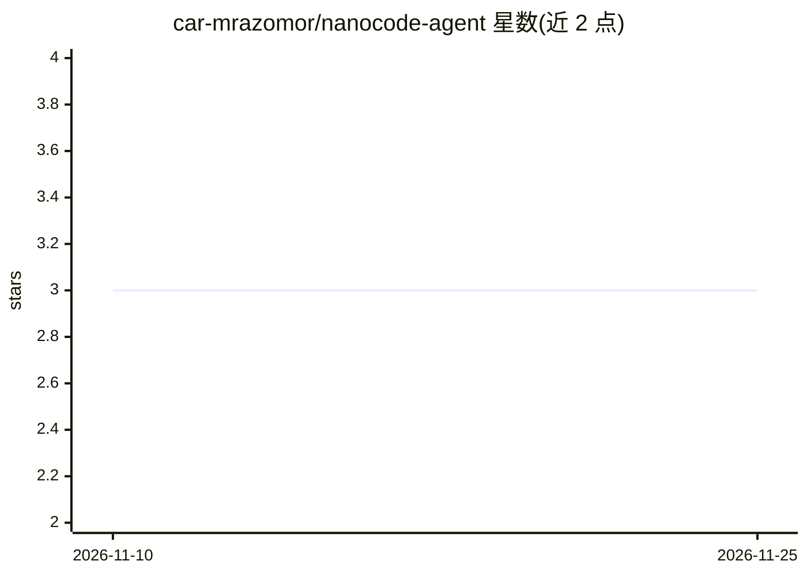

# car-mrazomor/nanocode-agent

⭐ 3 · Python · MIT · 推送 2026-11-23 · [GitHub](https://github.com/car-mrazomor/nanocode-agent) · [官网](https://car-mrazomor.github.io/nanocode-agent/) · 个人维护

**单文件可读可改的终端编程 Agent，接 Claude 订阅、OpenRouter 或 Ollama 本地模型**

运行在终端中的编程 Agent，全部代码在一个 Python 文件内，用户可通读并修改。它读写与编辑文件、运行命令和测试、以清单方式规划多步任务，并可将子任务交给并行运行的子代理处理。首次启动时选择供应商：Claude 订阅（经 Claude Agent SDK）、OpenRouter 任意云端模型或 Ollama 本地模型。支持任意 MCP 服务器接入、基于本地浏览器的网页搜索、多模型并排对比、邮件处理，编辑前展示 diff 并默认询问。安装通过 shell 脚本，文件集中存放于 ~/.nanocode。

## 筛选速览

| 维度 | 判定 | 备注 |
|---|---|---|
| AI 角色 | `ai-native` | 本体是模型或模型工具 |
| 许可风险 | `permissive` | MIT |
| 部署形态 | `library` | 以包/库形式分发 |
| 模型依赖 | local-ok | 支持本地模型 |
| 硬件要求 | — | 无带数字的原话,不猜 |
| 安装摩擦 | `low` | 无编译、无系统依赖或容器化 |
| 成熟度 | — | 结构信号不足 |

## 能力要点

- 单 Python 文件实现，可端到端阅读和修改
- 三种运行路径：Claude 订阅、OpenRouter 云模型、Ollama 本地模型
- 支持任意 MCP 服务器接入，可从 Claude Code/Claude Desktop 导入配置
- 子代理并行处理侧任务，编辑前展示 diff 并默认询问

## 适用场景

- 在终端里让 AI 读取代码库、修复失败的测试
- 用本地 Ollama 模型离线处理私有代码
- 把一个提示同时发给多个模型对比回答
- 接入自己的 MCP 服务器扩展 Agent 工具

## 场景标签

`编码 Agent` · 领域:编码与开发

## 证据(README 行号)

> L7: A small, hackable coding agent for your terminal, in one Python file you can read and edit end to end. **Website: ca
> L11: - **your Claude subscription**, through the Claude Agent SDK
> L15: With tools to read, edit and run code, plan and hand work to sub-agents, search the web through your own browser, u

## 星数曲线

2026-11-10 3 → 2026-11-25 3（+0）

---
*卡片 v1 · prompt 1.4 · 生成 2026-11-22 · 置信度 mid · 依据 README sha `49ee60aa6445` · [字段定义](../../DATASET.md)*
