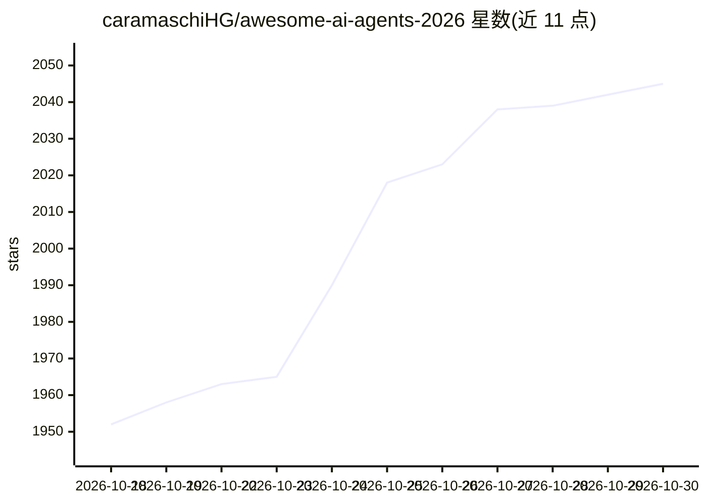

# caramaschiHG/awesome-ai-agents-2026

⭐ 2,045 · NOASSERTION · 推送 2026-06-10 · [GitHub](https://github.com/caramaschiHG/awesome-ai-agents-2026) · [官网](https://github.com/caramaschiHG/awesome-ai-agents-2026) · 个人维护

**AI agent 与工具策展清单（340+ 条，20+ 分类，月度更新）**

面向开发者的 awesome 类资源清单：收录 340+ 个 AI agent、框架与工具，按编码 agent、agent 框架、浏览器/桌面 agent、语音 agent、创意 AI、任务与工作流等 20+ 类别组织。条目以表格呈现名称、简介与定价，覆盖 IDE 原生/终端编码 agent、多 agent 编排框架、浏览器自动化、语音平台、图像/视频/音乐生成等内容，每月更新并接受社区 PR，许可证为 CC0-1.0。

## 筛选速览

| 维度 | 判定 | 备注 |
|---|---|---|
| AI 角色 | `ai-knowledge` | 知识聚合/清单类 |
| 许可风险 | `none` | NOASSERTION |
| 部署形态 | `library` | 以包/库形式分发 |
| 模型依赖 | — | README 未给出锁定关系 |
| 硬件要求 | — | 无带数字的原话,不猜 |
| 安装摩擦 | `low` | 无编译、无系统依赖或容器化 |
| 成熟度 | — | 结构信号不足 |

## 能力要点

- 340+ 资源按 20+ 分类组织，月度更新
- 编码 agent 覆盖 IDE、终端、自主软件工程师、代码审查四小类
- agent 框架含通用、多 agent 编排、轻量与模板四个板块
- 每条目附定价信息与语言/平台标注

## 适用场景

- 选型时按分类浏览 AI agent 与框架工具
- 了解编码/浏览器/语音/创意等方向的工具分布与定价
- 向清单提交 PR 补充新工具

## 场景标签

`精选清单` · 领域:学习与行业

## 证据(README 行号)

> L9:  The most comprehensive list of AI agents, frameworks, and tools in 2026.
> L10:  340+ resources across 20+ categories. Updated monthly.

## 星数曲线

2026-10-18 1,952 → 2026-10-30 2,045（+93）

---
*卡片 v1 · prompt 1.4 · 生成 2026-10-21 · 置信度 mid · 依据 README sha `a0649ff4d2b4` · [字段定义](../../DATASET.md)*
