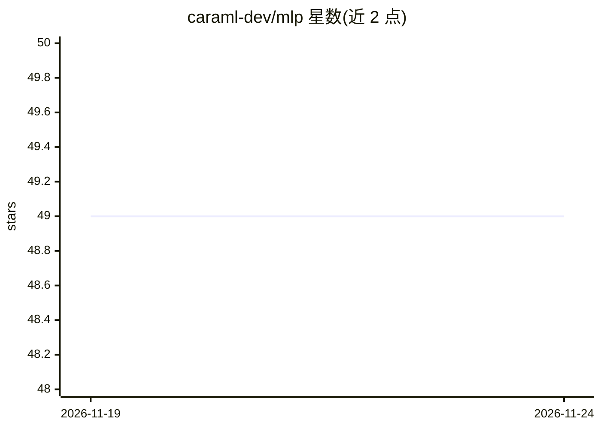

# caraml-dev/mlp

⭐ 49 · Go · Apache-2.0 · 推送 2026-11-18 · [GitHub](https://github.com/caraml-dev/mlp) · 组织维护

**面向开发与运维人员的机器学习全生命周期管理平台**

MLP 是一组面向机器学习生命周期各阶段的系统与服务集合，由多个子产品组成：Feast 用于管理与提供机器学习特征，Merlin 用于部署、服务与监控模型，Turing 用于设计、部署与评估实验。仓库本身提供 MLP Server，以 REST API 暴露 ML Project 等共享概念，并托管供各产品复用的 Go 与 React 库。运行依赖 Google OAuth 凭证，可通过 Docker Compose 一键启动，或以 Go、Node.js、Yarn 及 PostgreSQL、Keto、Vault 等依赖从源码构建。

## 筛选速览

| 维度 | 判定 | 备注 |
|---|---|---|
| AI 角色 | `ai-ecosystem` | LLM/agent 周边工具 |
| 许可风险 | `permissive` | Apache-2.0 |
| 部署形态 | `self-host` | docker 或自建部署 |
| 模型依赖 | — | README 未给出锁定关系 |
| 硬件要求 | — | 无带数字的原话,不猜 |
| 安装摩擦 | `low` | 无编译、无系统依赖或容器化 |
| 成熟度 | — | 结构信号不足 |

## 能力要点

- 覆盖 ML 生命周期多个阶段的多个子产品（Feast/Merlin/Turing）
- MLP Server 提供跨产品共享的 REST API 与 ML Project 概念
- 托管 Go 与 React (@caraml-dev/ui-lib) 公共库
- 支持 Docker Compose 与源码两种启动方式

## 适用场景

- 统一管理团队机器学习特征、模型部署与实验
- 为多个 ML 子产品提供共享的项目与 API 层
- 本地用 Docker Compose 搭建平台进行开发调试

## 场景标签

`MLOps` · 领域:训练与推理

## 证据(README 行号)

> L3: Machine Learning Platform (MLP) is a unified set of products for developing and operating the machine learning syste
> L7: MLP Products are systems and services that are specifically built to solve one or multiple stages of the machine lea
> L10: * **Merlin** - For deploying, serving, and monitoring machine learning models.

## 星数曲线

2026-11-19 49 → 2026-11-24 49（+0）

---
*卡片 v1 · prompt 1.4 · 生成 2026-11-19 · 置信度 high · 依据 README sha `a4d24b10cf8d` · [字段定义](../../DATASET.md)*
