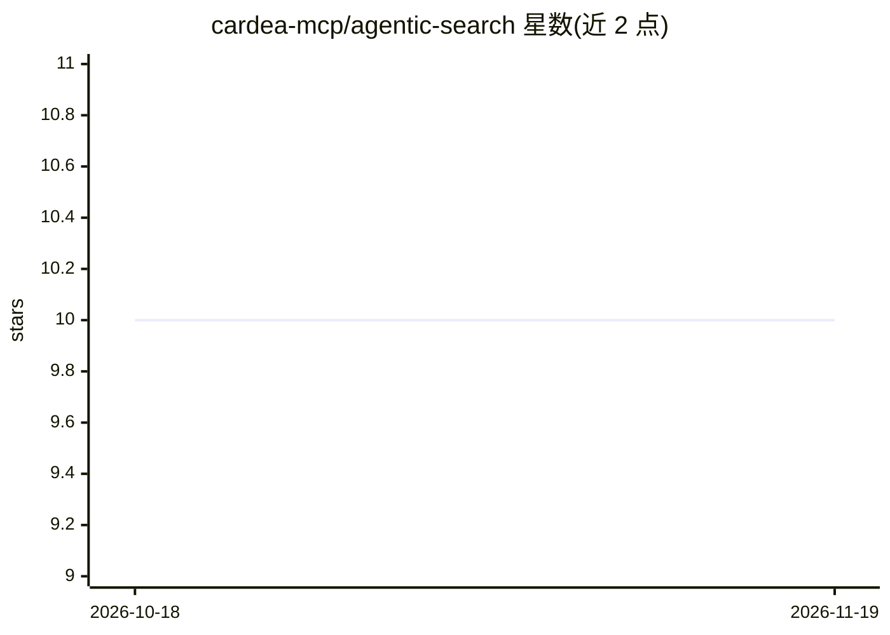

# cardea-mcp/agentic-search

⭐ 10 · Rust · 推送 2025-12-16 · [GitHub](https://github.com/cardea-mcp/agentic-search) · [官网](https://cardea.cc/) · 组织维护

**MCP 服务器：为 agent 提供向量与全文搜索能力**

一个实现 Model Context Protocol 的搜索服务器，提供 search 工具，对给定查询执行向量搜索（Qdrant）、关键词搜索（TiDB）或两者结合，返回搜索结果列表。面向使用 MCP 的 agent 应用提供检索能力。安装与用法说明位于独立的 USAGE.md 与 DEVELOPMENT.md 文档中，README 本身未包含安装命令。

## 筛选速览

| 维度 | 判定 | 备注 |
|---|---|---|
| AI 角色 | `ai-ecosystem` | LLM/agent 周边工具 |
| 许可风险 | `none` | — |
| 部署形态 | `None` |  |
| 模型依赖 | — | README 未给出锁定关系 |
| 硬件要求 | — | 无带数字的原话,不猜 |
| 安装摩擦 | `low` | 无编译、无系统依赖或容器化 |
| 成熟度 | — | 结构信号不足 |

## 能力要点

- 实现 Model Context Protocol 的搜索服务器
- 支持 Qdrant 向量搜索
- 支持 TiDB 关键词搜索，或两者结合
- 提供单一 search 工具并返回结果列表

## 适用场景

- 为 MCP agent 接入向量检索能力
- 对查询同时执行向量与关键词混合搜索

## 场景标签

`语义搜索` · 领域:知识与检索

## 证据(README 行号)

> L1: # Cardea Agentic Search
> L3: The Cardea Agentic Search is a Model Context Protocol (MCP) server that provides agentic search capabilities with su

## 星数曲线

2026-10-18 10 → 2026-11-19 10（+0）

---
*卡片 v1 · prompt 1.4 · 生成 2026-11-19 · 置信度 mid · 依据 README sha `bd3abab717e9` · [字段定义](../../DATASET.md)*
