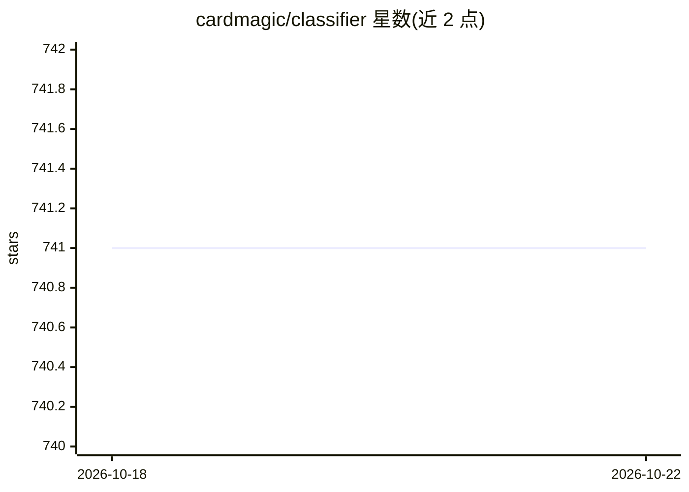

# cardmagic/classifier

⭐ 741 · Ruby · NOASSERTION · 推送 2026-10-17 · [GitHub](https://github.com/cardmagic/classifier) · 个人维护

**Ruby 文本分类库：贝叶斯/LSI/KNN/逻辑回归/TF-IDF**

Ruby 文本分类 Gem，提供 Naive Bayes、LSI、k-近邻、逻辑回归与 TF-IDF 五种算法，附 classifier 与 keywords 两个命令行工具（含预训练垃圾短信模型）。关键机制：LSI 使用自带 C 扩展加速（无扩展时回退纯 Ruby，无需 GSL），支持增量 LSI 免全量重建、流式训练多 GB 数据、可插拔持久化（文件/Redis/S3/SQL）。另提供 Claude Code 插件形式（技能与斜杠命令）。LGPL 2.1 许可。

## 筛选速览

| 维度 | 判定 | 备注 |
|---|---|---|
| AI 角色 | `ai-native` | 本体是模型或模型工具 |
| 许可风险 | `none` | NOASSERTION |
| 部署形态 | `None` |  |
| 模型依赖 | — | README 未给出锁定关系 |
| 硬件要求 | — | 无带数字的原话,不猜 |
| 安装摩擦 | `low` | 无编译、无系统依赖或容器化 |
| 成熟度 | — | 结构信号不足 |

## 能力要点

- 5 种算法：Bayes、LSI、KNN、逻辑回归、TF-IDF
- LSI 原生 C 扩展加速，回退纯 Ruby，无需 GSL
- 增量 LSI、流式训练、可插拔持久化（文件/Redis/S3/SQL）
- classifier 与 keywords CLI，支持预训练模型与自训练

## 适用场景

- 在 Ruby 项目中做垃圾文本/情感等文本分类
- 命令行直接用预训练模型检测垃圾短信
- 对大规模语料做 TF-IDF 关键词打分

## 场景标签

 · 领域:机器学习/NLP

## 证据(README 行号)

> L7: Text classification in Ruby. Five algorithms, native performance, streaming support.
> L130: classifier = Classifier::Bayes.new(:spam, :ham)

## 星数曲线

2026-10-18 741 → 2026-10-22 741（+0）

---
*卡片 v1 · prompt 1.4 · 生成 2026-10-21 · 置信度 high · 依据 README sha `ebd259a6a473` · [字段定义](../../DATASET.md)*
