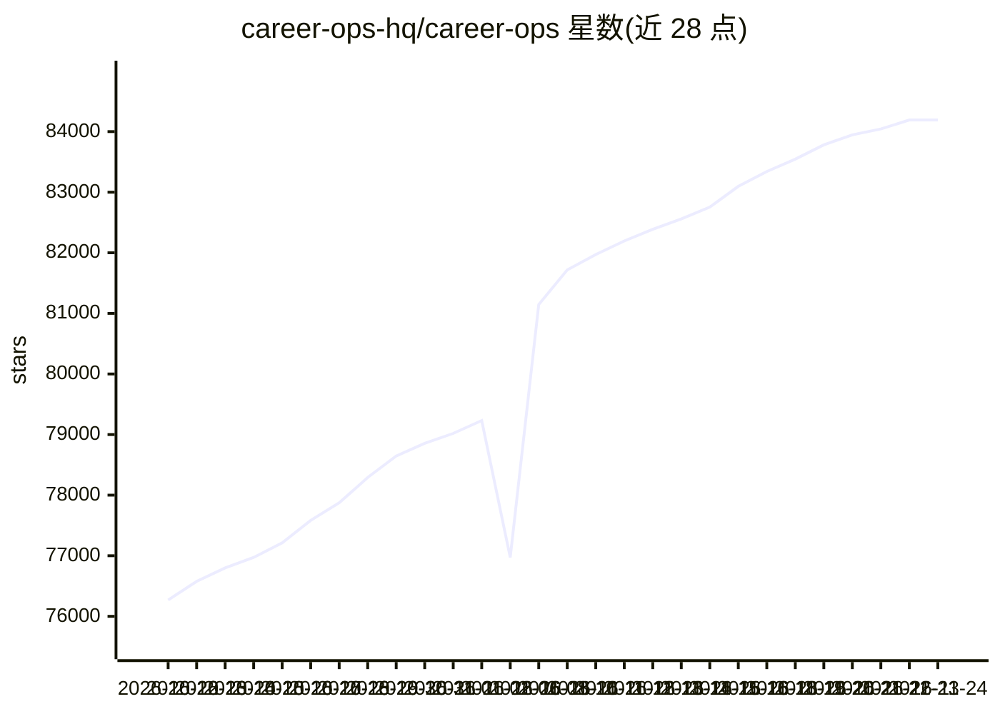

# career-ops-hq/career-ops

⭐ 84,192 · JavaScript · MIT · 推送 2026-11-22 · [GitHub](https://github.com/career-ops-hq/career-ops) · [官网](https://career-ops.org) · 个人维护

**本地运行的 AI 求职 agent：评估职位、定制简历与申请材料**

面向求职者的命令行 agent，运行在 Claude Code、Codex 等 AI CLI 中：粘贴职位后检查招聘是否仍开放、按真实 CV 对职位做 A-H 评估并打分（低于 4.0/5 会建议跳过）、生成 ATS 可读的定制简历与求职信 PDF、起草申请邮件与 LinkedIn 消息、维护申请追踪与拒绝模式分析。所有数据留在本机，不自动提交申请、不发送邮件；首次启动通过聊天完成配置。经 npx/npm 安装，PDF 生成需 Playwright chromium。

## 筛选速览

| 维度 | 判定 | 备注 |
|---|---|---|
| AI 角色 | `ai-native` | 本体是模型或模型工具 |
| 许可风险 | `permissive` | MIT |
| 部署形态 | `library` | 以包/库形式分发 |
| 模型依赖 | local-ok | 支持本地模型 |
| 硬件要求 | — | 无带数字的原话,不猜 |
| 安装摩擦 | `low` | 无编译、无系统依赖或容器化 |
| 成熟度 | — | 结构信号不足 |

## 动量与使用信号

- 维护:`active` — 距上次 push 0.6 天,年发版 55,464 位贡献者
- 涨星:近 1 天 **+212**(自 20261016 起算)
- 安装:npm 包 `@santifer/career-ops` 月下载 8,169
- 平台:— · 协议:OPENAI-API / OLLAMA

## 能力要点

- 按 JD 逐条加权评估 CV 匹配度，标注每条权重的来源
- 生成 ATS 可读简历与求职信 PDF（HTML + Playwright 管线）
- 180+ 公司门户扫描与 Ashby/Greenhouse/Lever/Wellfound 查询
- 永不自动提交或发送：只起草，用户点击 Submit

## 适用场景

- 申请前按自己的 CV 评估职位匹配度，决定是否投递
- 为每个 JD 生成定制简历与求职信 PDF
- 追踪申请漏斗并分析拒绝模式与重复发布的职位
- 准备面试故事库与薪资谈判脚本

## 场景标签

`AI 写作` · 领域:内容生成

## 证据(README 行号)

> L34: Paste a job. On your machine, it tells you if it's still&nbsp;open and if it&nbsp;fits.
> L133: |**Human-in-the-Loop**|AI evaluates and recommends, you decide and act. The system never submits an application --
> L209: - **Without an AI CLI:** standalone Gemini, Ollama and OpenAI-compatible scripts evaluate a JD on their own. See d

## 星数曲线

2026-10-22 76,270 → 2026-11-24 84,192（+7,922）

---
*卡片 v1 · prompt 1.4 · 生成 2026-11-22 · 置信度 high · 依据 README sha `f73238697a58` · [字段定义](../../DATASET.md)*
