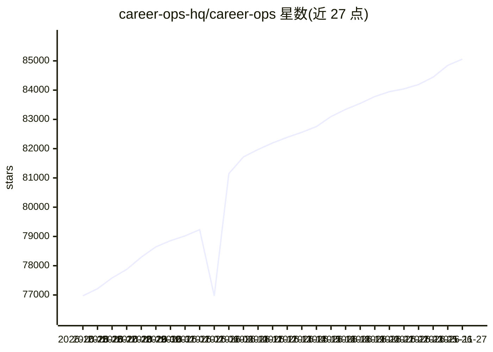

# career-ops-hq/career-ops

⭐ 85,059 · JavaScript · MIT · 推送 2026-11-26 · [GitHub](https://github.com/career-ops-hq/career-ops) · [官网](https://career-ops.org) · 个人维护

**本地运行的 AI 求职 agent：评分匹配、定制简历与求职信**

运行在 AI coding CLI（Claude Code/Codex 等）中的求职助手工作区：粘贴职位后检查招聘是否仍有效、按用户真实 CV 做 1-5 匹配评分、生成 ATS 可读的定制 PDF 简历与求职信、准备 STAR+R 面试素材并维护申请追踪。机制上为 human-in-the-loop：只起草不提交，脚本不做网络提交与邮件发送，数据留在本机。安装通过 npm/npx，PDF 生成需另装 Playwright chromium。

## 筛选速览

| 维度 | 判定 | 备注 |
|---|---|---|
| AI 角色 | `ai-native` | 本体是模型或模型工具 |
| 许可风险 | `permissive` | MIT |
| 部署形态 | `library` | 以包/库形式分发 |
| 模型依赖 | local-ok | 支持本地模型 |
| 硬件要求 | — | 无带数字的原话,不猜 |
| 安装摩擦 | `low` | 无编译、无系统依赖或容器化 |
| 成熟度 | — | 结构信号不足 |

## 动量与使用信号

- 维护:`active` — 距上次 push 0.6 天,年发版 55,464 位贡献者
- 涨星:近 1 天 **+212**(自 20261016 起算)
- 安装:npm 包 `@santifer/career-ops` 月下载 8,169
- 平台:— · 协议:OPENAI-API / OLLAMA

## 能力要点

- A-H 评估：JD 匹配评分、薪酬调研、面试准备、招聘真实性检查
- 基于 Playwright HTML 管线的 ATS PDF 简历与 A4 求职信生成
- Portal Scanner 预配置 180+ 公司并覆盖 Ashby/Greenhouse/Lever/Wellfound
- 拒绝模式分析、重发检测、漏斗统计与申请追踪 TUI

## 适用场景

- 申请前判断某个职位与我的 CV 是否匹配、是否值得投
- 针对每个 JD 定制生成 ATS 友好的简历和求职信 PDF
- 追踪所有投递记录并分析被拒规律
- 集中浏览 180+ 公司的招聘门户职位

## 场景标签

`浏览器自动化` · 领域:效率与自动化

## 证据(README 行号)

> L109: - **Not you?** It scores the role against your real CV and tells you to skip a weak fit. You can override it.
> L110: - **Worth it?** It drafts the CV, the cover letter and the answers. You read them. You send them.
> L123: - **Phone home.** No telemetry, no backend of ours. Your CV goes from your machine to the AI provider you chose, a

## 星数曲线

2026-10-25 76,972 → 2026-11-27 85,059（+8,087）

---
*卡片 v1 · prompt 1.4 · 生成 2026-11-24 · 置信度 high · 依据 README sha `3f4853b342b9` · [字段定义](../../DATASET.md)*
