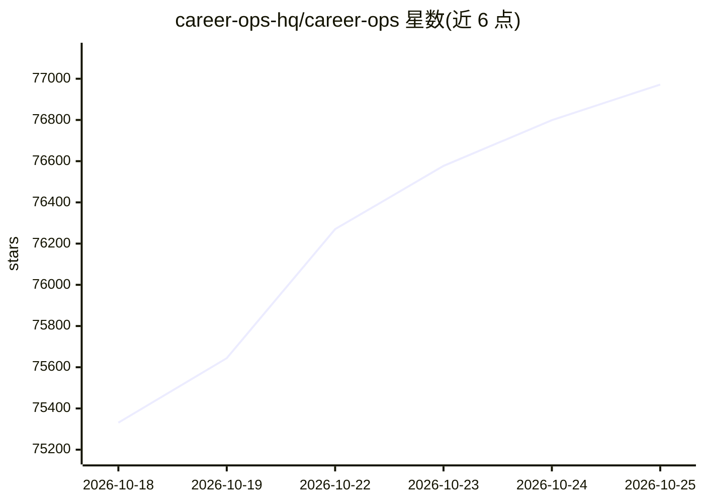

# career-ops-hq/career-ops

⭐ 76,972 · JavaScript · MIT · 推送 2026-10-24 · [GitHub](https://github.com/career-ops-hq/career-ops) · [官网](https://career-ops.org) · 个人维护

**给求职者的本地 AI 求职 agent：评分匹配并代拟申请材料**

运行在用户已有 AI CLI（Claude Code、Codex 等）中的求职辅助系统：粘贴职位后检查岗位是否仍开放、按用户真实 CV 做 A-H 多维评估（1-5 评分、低于 4.0 提示不投）、生成 ATS 可读 PDF 简历与求职信草稿、STAR+R 面试准备、申请追踪与漏斗统计。设计上不自动提交、不发邮件、无遥测，数据全部留在本机；支持批量无头 worker、100+ 公司门户扫描、可选插件集成。经 npx 或全局 npm 安装。

## 筛选速览

| 维度 | 判定 | 备注 |
|---|---|---|
| AI 角色 | `ai-native` | 本体是模型或模型工具 |
| 许可风险 | `permissive` | MIT |
| 部署形态 | `library` | 以包/库形式分发 |
| 模型依赖 | — | README 未给出锁定关系 |
| 硬件要求 | — | 无带数字的原话,不猜 |
| 安装摩擦 | `low` | 无编译、无系统依赖或容器化 |
| 成熟度 | — | 结构信号不足 |

## 动量与使用信号

- 维护:`active` — 距上次 push 0.6 天,年发版 55,464 位贡献者
- 涨星:近 1 天 **+212**(自 20261016 起算)
- 安装:npm 包 `@santifer/career-ops` 月下载 8,169
- 平台:— · 协议:OPENAI-API / OLLAMA

## 能力要点

- 按用户 CV 对职位做 A-H 评估打分（1-5），低于 4.0 默认劝阻投递并允许覆盖
- ATS 可读简历与求职信 PDF 生成（HTML + Playwright 流水线）
- 人工在环设计：脚本不 POST、不发邮件，用户亲自点击 Submit
- 批量并行评估、重发检测、拒绝模式分析与终端 TUI 看板

## 适用场景

- 投递前判断某岗位与我的 CV 匹配度是否值得花时间
- 针对具体 JD 定制 ATS 友好的简历和求职信
- 追踪所有申请状态并分析被拒模式与漏斗数据
- 准备行为面试问题并整理可复用的 STAR 故事库

## 场景标签

`AI 写作` `网页抓取` · 领域:效率与自动化

## 证据(README 行号)

> L76:  Open source. Local. In the AI CLI you already use. Free and local models included.
> L110: - **Where does it all go?** Every application stays on your machine. Nothing is uploaded to us.
> L171: claude   # or codex / qwen / opencode / agy / grok — open your AI CLI here

## 星数曲线

2026-10-18 75,331 → 2026-10-25 76,972（+1,641）

---
*卡片 v1 · prompt 1.4 · 生成 2026-10-18 · 置信度 high · 依据 README sha `ec2f980dcd1c` · [字段定义](../../DATASET.md)*
