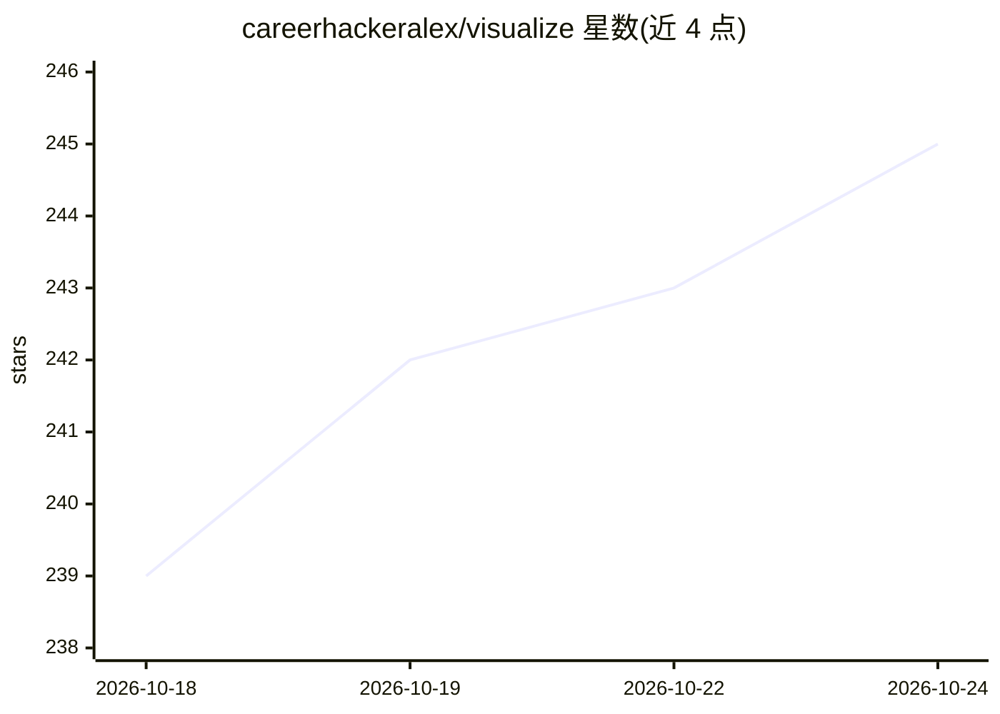

# careerhackeralex/visualize

⭐ 246 · JavaScript · MIT · 推送 2026-03-06 · [GitHub](https://github.com/careerhackeralex/visualize) · 个人维护

**用一句话生成自包含 HTML 可视化（幻灯片/仪表盘/信息图）的 Claude Code 插件**

Claude Code 插件：用户以自然语言描述可视化需求，Claude Code 读取内置技能指令（设计系统、模式、最佳实践），生成单个自包含 .html 文件，支持幻灯片、仪表盘、信息图、流程图、时间线、思维导图、看板等 10 类形式。输出带明暗主题、PNG 下载、打印/PDF、响应式与键盘导航，可选加载 Chart.js/D3/Mermaid 等 CDN 库。通过 Claude Code 插件市场安装，也可 git clone 手动安装。

## 筛选速览

| 维度 | 判定 | 备注 |
|---|---|---|
| AI 角色 | `ai-ecosystem` | LLM/agent 周边工具 |
| 许可风险 | `permissive` | MIT |
| 部署形态 | `None` |  |
| 模型依赖 | locked-api |  |
| 硬件要求 | — | 无带数字的原话,不猜 |
| 安装摩擦 | `low` | 无编译、无系统依赖或容器化 |
| 成熟度 | — | 结构信号不足 |

## 能力要点

- 从自然语言生成单个自包含 HTML 文件，覆盖 10 类可视化形式
- 输出自带明暗主题、PNG 导出、打印/PDF、响应式与键盘导航
- 技能内置排版/配色/间距等设计系统指令
- 可选使用 Chart.js、D3、Mermaid、Three.js 等 CDN 库

## 适用场景

- 让 Claude Code 生成可分享的演示文稿或信息图
- 把 CSV/JSON 数据转成交互式仪表盘
- 为部署流程或时间线快速产出图示

## 场景标签

`代码生成` `数据分析` · 领域:效率与自动化

## 证据(README 行号)

> L5: A Claude Code plugin that creates stunning, self-contained HTML visualizations from natural language. Slide decks, d
> L72: ### Claude Code Plugin (recommended)
> L128: 2. Claude Code reads the skill instructions (design system, patterns, best practices)

## 星数曲线

2026-10-18 239 → 2026-10-24 245（+6）

---
*卡片 v1 · prompt 1.4 · 生成 2026-10-22 · 置信度 high · 依据 README sha `a96660ce5448` · [字段定义](../../DATASET.md)*
