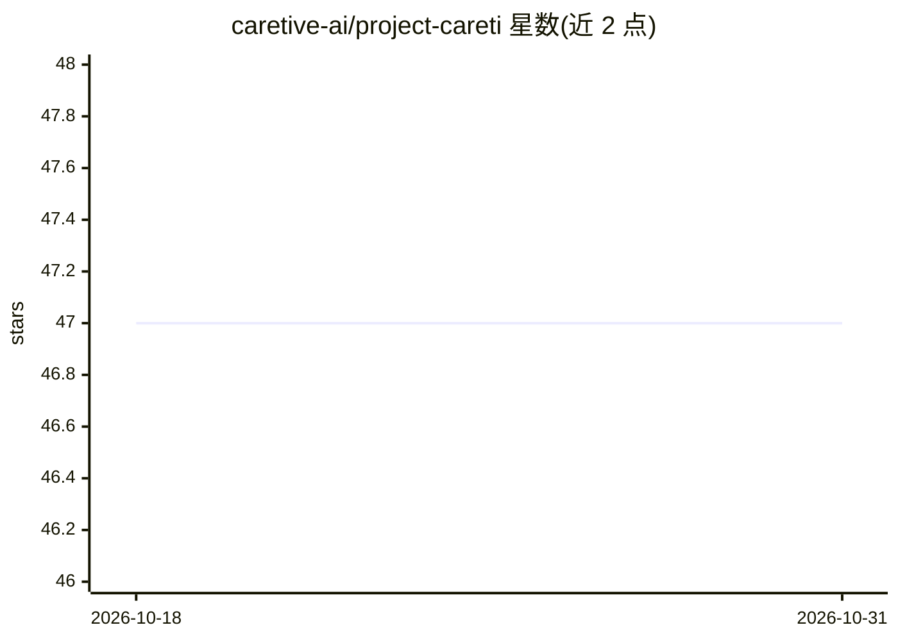

# caretive-ai/project-careti

⭐ 47 · JavaScript · Apache-2.0 · 推送 2026-07-29 · [GitHub](https://github.com/caretive-ai/project-careti) · [官网](https://careti.ai) · 组织维护

**Cline 兼容的 VS Code AI 编程 agent 扩展，双模式运行**

基于 Cline 的 VS Code 扩展，可直接沿用既有 Cline 设置与账户，支持 31 个 provider、266 个模型。提供 Cline Mode（Plan/Act 流程）与 Careti Mode（角色、本地化、优化提示词）双模式切换；含消息队列、ESC 即时取消、CLI Agent 模式、/init 项目上下文生成、图像生成/分析与 HWP/PDF/DOCX/PPTX 文档读取等 19 项功能。另提供基于 Tauri 的独立桌面应用（需从源码构建），通过 VS Code Marketplace 安装。

## 筛选速览

| 维度 | 判定 | 备注 |
|---|---|---|
| AI 角色 | `ai-ecosystem` | LLM/agent 周边工具 |
| 许可风险 | `permissive` | Apache-2.0 |
| 部署形态 | `library` | 以包/库形式分发 |
| 模型依赖 | — | README 未给出锁定关系 |
| 硬件要求 | — | 无带数字的原话,不猜 |
| 安装摩擦 | `low` | 无编译、无系统依赖或容器化 |
| 成熟度 | — | 结构信号不足 |

## 能力要点

- Cline 设置/账户原样沿用，31 providers、266 models
- Cline Mode 与 Careti Mode（Persona/本地化）双模式切换
- /init 自动生成 AI 优化与人类可读的双目录上下文（1:1 镜像）
- 消息队列系统、CLI Agent/Chatbot 模式、图像与文档工具

## 适用场景

- Cline 用户迁移后继续使用原有配置并使用扩展功能
- 在 VS Code 中通过对话式 agent 进行编程与项目上下文管理
- 脱离 VS Code 用桌面应用独立运行

## 场景标签

`编码 Agent` · 领域:编码与开发

## 证据(README 行号)

> L37:  Use your Cline settings as-is, with more features, 266 models, free monthly credits
> L64: ## 🔄 Cline Compatible + Extended
> L69: - 31 providers, 266 models supported

## 星数曲线

2026-10-18 47 → 2026-10-31 47（+0）

---
*卡片 v1 · prompt 1.4 · 生成 2026-10-25 · 置信度 mid · 依据 README sha `1e73d11c86fe` · [字段定义](../../DATASET.md)*
