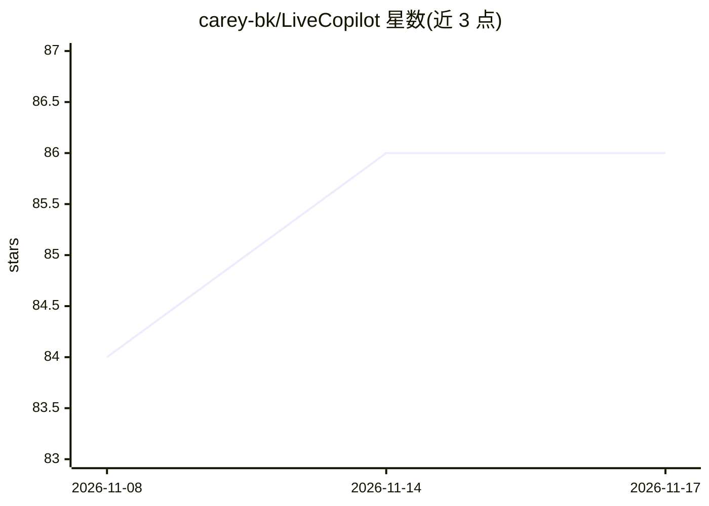

# carey-bk/LiveCopilot

⭐ 86 · Swift · MIT · 推送 2026-11-16 · [GitHub](https://github.com/carey-bk/LiveCopilot) · [官网](https://carey-bk.github.io/LiveCopilot/) · 个人维护 · 中文 README

**macOS 原生实时转录与知识检索问答助手**

以 Swift/SwiftUI 编写的 macOS 桌面应用，面向访谈、会议与学术讨论：通过麦克风或系统音频实时转录语音（本地 Zipformer/Paraformer/Apple 或 OpenAI Live），从导入的 PDF/Markdown/DOCX/TXT 文档中检索相关段落（本地 BGE-M3 或 OpenAI Embeddings），并调用用户自选的分析 API（OpenAI、DeepSeek、Qwen、GLM、Kimi 等）在悬浮窗中流式给出回答建议。密钥存本地 Keychain，无账号与中转服务器。提供签名公证的 DMG，也可用 Xcode 从源码构建。

## 筛选速览

| 维度 | 判定 | 备注 |
|---|---|---|
| AI 角色 | `ai-native` | 本体是模型或模型工具 |
| 许可风险 | `permissive` | MIT |
| 部署形态 | `None` |  |
| 模型依赖 | locked-api |  |
| 硬件要求 | — | 无带数字的原话,不猜 |
| 安装摩擦 | `medium` | 含编译或系统依赖之一 |
| 成熟度 | — | 结构信号不足 |

## 能力要点

- 实时语音转录与可选流式翻译，悬浮窗内查看回答与引用来源
- 本地文档知识库检索（BGE-M3 本地运行）与三种回答模式
- 处理位置可选：语音识别、索引可全部留在本机，仅回答走 API
- API 密钥存本地 Keychain，无账号与开发者中转服务器

## 适用场景

- 面试或会议中实时转录并获得带文档出处的回答提示
- 不开启麦克风直接输入问题查询本地知识库
- 学术讨论时引用自己导入的论文资料生成回答

## 场景标签

`AI 助手` `语音识别` `文档问答` · 领域:对话与助手

## 证据(README 行号)

> L9: A native macOS assistant for interviews, meetings and academic discussions. LiveCopilot transcribes speech, retrieve
> L57: |Speech recognition|Local Zipformer, Paraformer or Apple; OpenAI Live|Local recognition stays on-device. OpenAI Liv

## 星数曲线

2026-11-08 84 → 2026-11-17 86（+2）

---
*卡片 v1 · prompt 1.4 · 生成 2026-11-17 · 置信度 high · 依据 README sha `f3c497eac4bc` · [字段定义](../../DATASET.md)*
