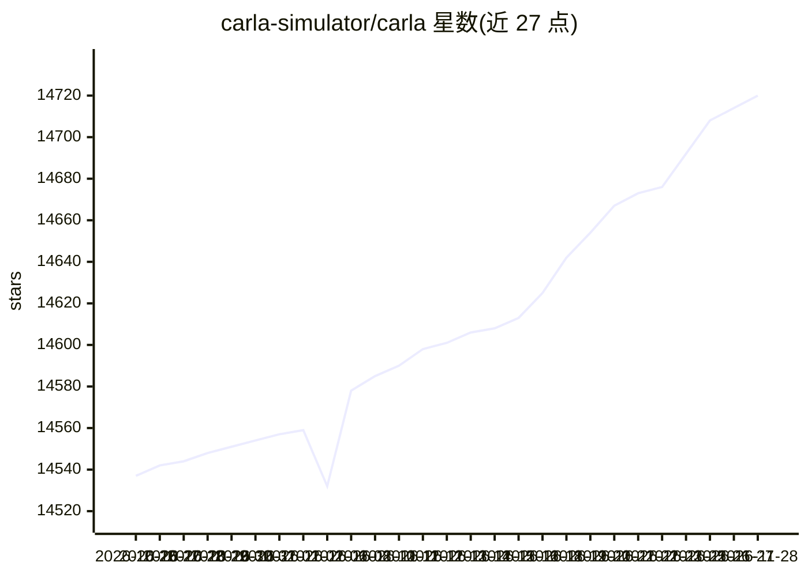

# carla-simulator/carla

⭐ 14,720 · C++ · MIT · 推送 2026-11-27 · [GitHub](https://github.com/carla-simulator/carla) · [官网](http://carla.org) · 组织维护

**自动驾驶研究开源仿真器：训练、验证驾驶系统**

CARLA 是面向自动驾驶研究的开源仿真平台，从底层设计用于自动驾驶系统的开发、训练与验证。提供开源数字资产（城市布局、建筑、车辆）并支持灵活配置传感器套件与环境条件。围绕平台有排行榜、Scenario_Runner、ROS-bridge、Driving-benchmarks 等生态仓库。本分支为 UE5.8 版（与 UE4.26 版并行维护），需链接 Epic Games 账户获取 Unreal Engine fork 后从源码构建，Linux/Windows 均给出配置与重建命令；代码 MIT 许可，资产 CC-BY 许可。

## 筛选速览

| 维度 | 判定 | 备注 |
|---|---|---|
| AI 角色 | `ai-native` | 本体是模型或模型工具 |
| 许可风险 | `permissive` | MIT |
| 部署形态 | `None` |  |
| 模型依赖 | — | README 未给出锁定关系 |
| 硬件要求 | — | 无带数字的原话,不猜 |
| 安装摩擦 | `medium` | 含编译或系统依赖之一 |
| 成熟度 | — | 结构信号不足 |

## 动量与使用信号

- 维护:`active` — 距上次 push 0.8 天,年发版 0,173 位贡献者
- 涨星:近 1 天 **+5**(自 20261016 起算)
- 安装:github 包 `release-assets` 月下载无数据
- 平台:WINDOWS / LINUX · 协议:—

## 能力要点

- 开源代码、协议与可自由使用的数字资产（城市布局、建筑、车辆）
- 支持灵活指定传感器套件与环境条件
- 生态含自动驾驶排行榜、Scenario_Runner、ROS-bridge、基准工具
- 提供 Python API 并可随构建安装

## 适用场景

- 训练与验证自动驾驶算法栈
- 在仿真中运行条件模仿学习/强化学习模型
- 通过 ROS-bridge 或 AutoWare 桥接接入机器人系统
- 生成交通场景做基准测试

## 场景标签

`模型评测` `强化学习` `科研工具` · 领域:评测与运维

## 证据(README 行号)

> L11: CARLA is an open-source simulator for autonomous driving research. CARLA has been developed from the ground up to s
> L12: validation of autonomous driving systems. In addition to open-source code and protocols, CARLA provides open digita
> L50: * **Conditional Imitation-Learning**: Training and testing Conditional Imitation Learning models in CARLA

## 星数曲线

2026-10-26 14,537 → 2026-11-28 14,720（+183）

---
*卡片 v1 · prompt 1.4 · 生成 2026-11-23 · 置信度 high · 依据 README sha `136d002f3c77` · [字段定义](../../DATASET.md)*
