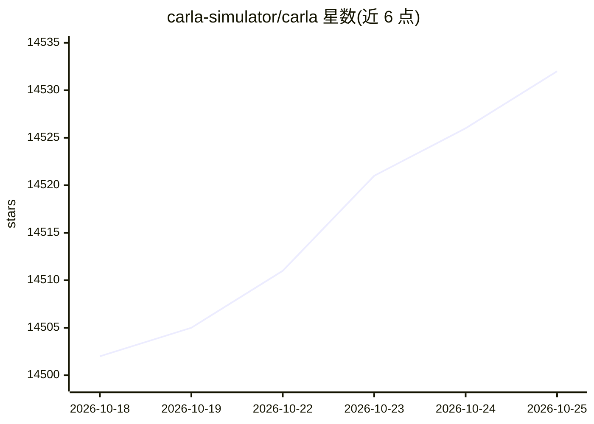

# carla-simulator/carla

⭐ 14,532 · C++ · MIT · 推送 2026-10-23 · [GitHub](https://github.com/carla-simulator/carla) · [官网](http://carla.org) · 组织维护

**开源自动驾驶研究仿真器，支持系统开发、训练与验证**

基于 Unreal Engine 的开源自动驾驶仿真平台，提供开放数字资产（城市布局、建筑、车辆）、可配置的传感器套件与环境条件，配套 Python API、ROS 桥接、排行榜与基准测试等生态仓库。当前 README 对应 UE 5.8 开发分支（ue58-dev），与 UE 4.26 分支并行且差异显著。构建需先获取 CARLA 定制的 Unreal Engine 5.8 fork（需绑定 Epic Games 账号），经 CarlaSetup 脚本与 cmake 编译，或经官网下载页获取打包版本。推荐 32GB 内存与 RTX 3070 级以上显卡，仅支持 Ubuntu 22.04/24.04 或 Windows 11。

## 筛选速览

| 维度 | 判定 | 备注 |
|---|---|---|
| AI 角色 | `ai-ecosystem` | LLM/agent 周边工具 |
| 许可风险 | `permissive` | MIT |
| 部署形态 | `None` |  |
| 模型依赖 | — | README 未给出锁定关系 |
| 硬件要求 | — | 无带数字的原话,不猜 |
| 安装摩擦 | `medium` | 含编译或系统依赖之一 |
| 成熟度 | — | 结构信号不足 |

## 动量与使用信号

- 维护:`active` — 距上次 push 0.8 天,年发版 0,173 位贡献者
- 涨星:近 1 天 **+5**(自 20261016 起算)
- 安装:github 包 `release-assets` 月下载无数据
- 平台:WINDOWS / LINUX · 协议:—

## 能力要点

- 提供城市布局、建筑、车辆等开放数字资产
- 支持传感器套组与环境条件的灵活配置
- 配套 Python API、ROS-bridge、排行榜与基准工具等生态仓库
- 有 CoRL'17 论文可引用

## 适用场景

- 自动驾驶系统（含模仿学习/强化学习模型）的训练与验证
- 交通场景执行与自动驾驶排行榜评测
- 与 ROS/AutoWare 栈联动的仿真测试

## 场景标签

`模型评测` · 领域:评测与运维

## 证据(README 行号)

> L11: CARLA is an open-source simulator for autonomous driving research. CARLA has been developed from the ground up to s
> L12: validation of autonomous driving systems. In addition to open-source code and protocols, CARLA provides open digita
> L50: * **Conditional Imitation-Learning**: Training and testing Conditional Imitation Learning models in CARLA

## 星数曲线

2026-10-18 14,502 → 2026-10-25 14,532（+30）

---
*卡片 v1 · prompt 1.4 · 生成 2026-10-20 · 置信度 high · 依据 README sha `65524ccf7b8b` · [字段定义](../../DATASET.md)*
