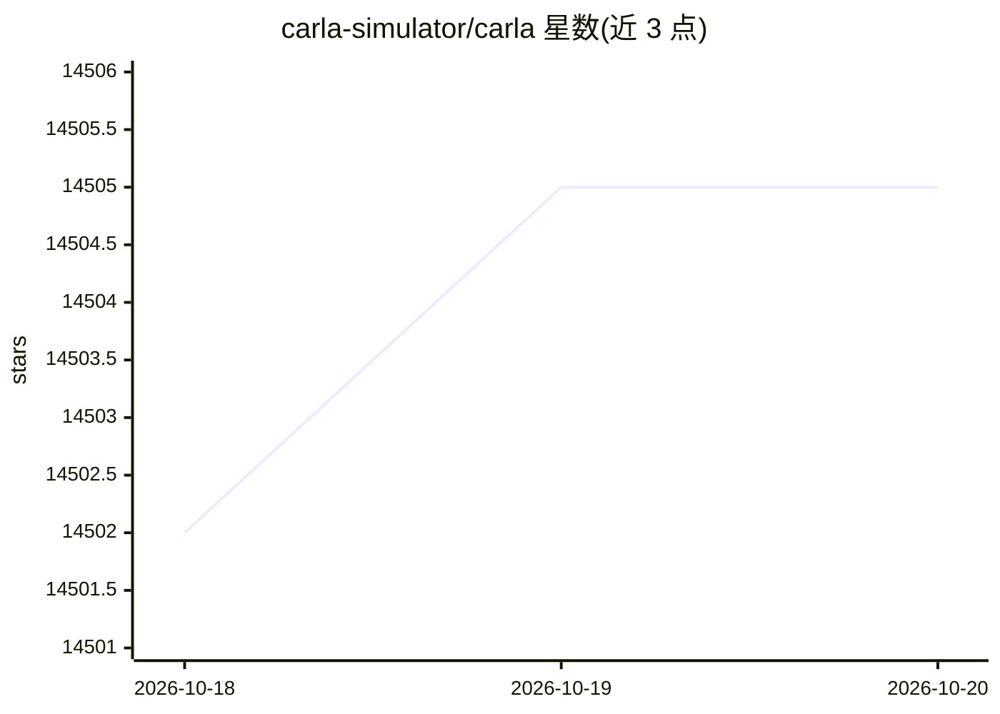

# carla-simulator/carla

⭐ 14,505 · C++ · MIT · 推送 2026-10-19 · [GitHub](https://github.com/carla-simulator/carla) · [官网](http://carla.org) · 组织维护

**面向自动驾驶研究的开源仿真器**

CARLA 是面向自动驾驶系统开发、训练与验证的开源仿真器，提供开源代码、协议及可自由使用的城市布局、建筑、车辆等数字资产，支持灵活配置传感器组合与环境条件。当前 ue5-dev 分支基于 Unreal Engine 5.5，与 ue4-dev 分支并行维护。Linux/Windows 通过官方 setup 脚本从源码构建，需事先关联 Epic Games 账号以访问 UE5 fork，构建消耗较大磁盘空间与时间；项目有 CoRL'17 论文引用要求与 MIT/CC-BY 双重许可安排。

## 筛选速览

| 维度 | 判定 | 备注 |
|---|---|---|
| AI 角色 | `ai-ecosystem` | LLM/agent 周边工具 |
| 许可风险 | `dual` | MIT |
| 部署形态 | `None` |  |
| 模型依赖 | — | README 未给出锁定关系 |
| 硬件要求 | — | 无带数字的原话,不猜 |
| 安装摩擦 | `medium` | 含编译或系统依赖之一 |
| 成熟度 | — | 结构信号不足 |

## 动量与使用信号

- 维护:`active` — 距上次 push 0.8 天,年发版 0,173 位贡献者
- 涨星:近 1 天 **+5**(自 20261016 起算)
- 平台:WINDOWS / LINUX · 协议:—

## 能力要点

- 开源仿真器附带可自由使用的城市、车辆等数字资产
- 支持灵活指定传感器组合与环境条件
- 提供 ROS-bridge、Scenario_Runner、自动排行榜等生态仓库
- 提供 Python API 与蓝图库，跨 Linux/Windows 平台

## 适用场景

- 搭建自动驾驶感知/规划算法的训练与验证仿真环境
- 在仿真中运行模仿学习或强化学习模型
- 执行交通场景测试并接入 ROS/AutoWare 栈

## 场景标签

 · 领域:自动驾驶研究/仿真

## 证据(README 行号)

> L11: CARLA is an open-source simulator for autonomous driving research. CARLA has been developed from the ground up to s
> L19: > This is the development branch `ue5-dev` for the **Unreal Engine 5.5 version of CARLA**. This branch exists in pa
> L82: In order to build CARLA, you need access to the CARLA fork of Unreal Engine 5.5. In order to access this repository

## 星数曲线

2026-10-18 14,502 → 2026-10-20 14,505（+3）

---
*卡片 v1 · prompt 1.4 · 生成 2026-10-18 · 置信度 high · 依据 README sha `93c738ec86d1` · [字段定义](../../DATASET.md)*
