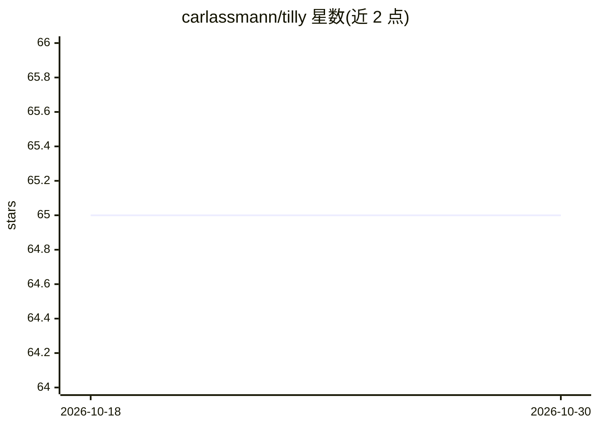

# carlassmann/tilly

⭐ 65 · TypeScript · MIT · 推送 2026-10-29 · [GitHub](https://github.com/carlassmann/tilly) · [官网](https://tilly.social) · 个人维护

**带 AI 助手的关系记录本地优先 PWA 日记应用**

面向个人用户的关系管理（personal CRM）日记应用：为每个人建立独立记录空间，追踪重要事项并在合适时机提醒联系；Tilly Chat 可把对话整理为记忆与提醒。本体是 React PWA，采用 Jazz 客户端加密、离线优先与实时协作数据库，数据支持 JSON 导入导出。AI 助手基于 AI SDK + Google Gemini，是唯一需联网的功能。需自备 Clerk 认证与 Gemini API key，可用 bun 从源码运行，另有 tilly.social 托管服务（30 天免费试用，Plus $6/月）。

## 筛选速览

| 维度 | 判定 | 备注 |
|---|---|---|
| AI 角色 | `ai-enhanced` | 去掉 AI 部分产品仍成立 |
| 许可风险 | `permissive` | MIT |
| 部署形态 | `None` |  |
| 模型依赖 | — | README 未给出锁定关系 |
| 硬件要求 | — | 无带数字的原话,不猜 |
| 安装摩擦 | `low` | 无编译、无系统依赖或容器化 |
| 成熟度 | — | 结构信号不足 |

## 能力要点

- Jazz 客户端加密、离线优先、实时协作的本地优先架构
- Tilly Chat 将对话转化为组织化的记忆与提醒
- 数据在浏览器端加密后同步，服务端仅用于推送与助手功能
- 完整 JSON 导入导出，无供应商锁定

## 适用场景

- 记录朋友与家人的重要事件并按时跟进
- 通过对话式 AI 助手快速整理人际记忆与提醒
- 自托管或使用托管版管理个人关系数据

## 场景标签

`AI 助手` `知识库管理` · 领域:对话与助手

## 证据(README 行号)

> L5: Tilly is an open-source relationship journal that helps you stay connected with the people who matter most. Built as
> L64: **Offline-First**: All data syncs through Jazz and works offline. AI assistant is the only feature requiring an act

## 星数曲线

2026-10-18 65 → 2026-10-30 65（+0）

---
*卡片 v1 · prompt 1.4 · 生成 2026-10-24 · 置信度 high · 依据 README sha `83b074f200db` · [字段定义](../../DATASET.md)*
