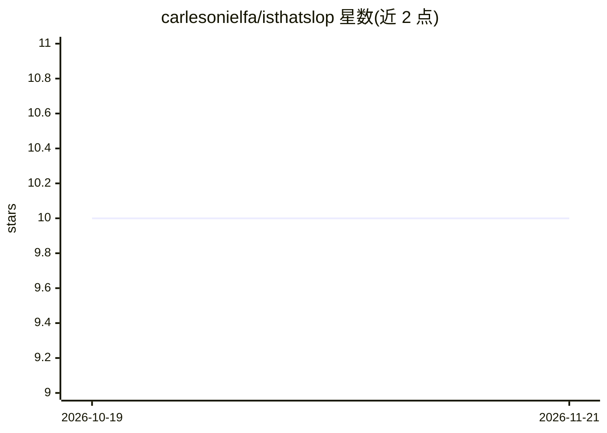

# carlesonielfa/isthatslop

⭐ 10 · TypeScript · AGPL-3.0 · 推送 2026-03-14 · [GitHub](https://github.com/carlesonielfa/isthatslop) · [官网](https://isthatslop.com) · 个人维护

**社区众包识别与分级 AI 生成内容的平台**

开源社区平台，用户提交关于内容来源使用 AI 的 claims（描述、影响度、置信度、证据），平台基于聚合证据算法计算 0-4 五级评分，并按网站/出版物/作者/文章五层层级组织来源、子级分数影响父级。借鉴 ProtonDB 社区评分模式。技术栈为 Bun + Next.js + PostgreSQL/Drizzle + better-auth，需 Docker 运行本地数据库，目前为开发中的进行时项目，浏览器扩展处于计划状态。

## 筛选速览

| 维度 | 判定 | 备注 |
|---|---|---|
| AI 角色 | `ai-enhanced` | 去掉 AI 部分产品仍成立 |
| 许可风险 | `viral` | AGPL-3.0 |
| 部署形态 | `None` |  |
| 模型依赖 | — | README 未给出锁定关系 |
| 硬件要求 | — | 无带数字的原话,不猜 |
| 安装摩擦 | `low` | 无编译、无系统依赖或容器化 |
| 成熟度 | `idea` | |

## 能力要点

- 基于 claims 的评分模型：用户提交证据而非直接投票
- 0-4 五级分级由聚合 claims 算法计算
- 来源按最多 5 层层级组织，子级分数影响父级
- Windows 95 复古界面风格

## 适用场景

- 提交在某网站/文章中发现的 AI 使用证据
- 查询某内容来源的 AI 使用综合评级
- 参与社区共建 AI 内容透明度数据库

## 场景标签

 · 领域:AI 内容检测/社区评分平台

## 证据(README 行号)

> L3: A community-driven database for identifying and evaluating whether content sources are AI-generated or human-created
> L9: Unlike traditional rating systems where users vote on a score directly, IsThatSlop uses a **claims-based model**: us
> L59: - **Database**: PostgreSQL with Drizzle ORM

## 星数曲线

2026-10-19 10 → 2026-11-21 10（+0）

---
*卡片 v1 · prompt 1.4 · 生成 2026-11-19 · 置信度 mid · 依据 README sha `1cb810ebfa11` · [字段定义](../../DATASET.md)*
