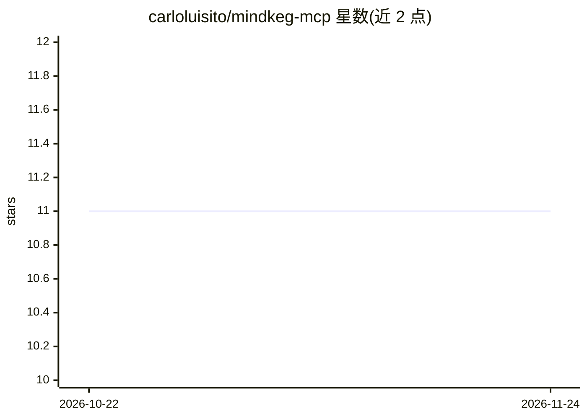

# carloluisito/mindkeg-mcp

⭐ 11 · TypeScript · MIT · 推送 2026-04-13 · [GitHub](https://github.com/carloluisito/mindkeg-mcp) · [官网](https://github.com/carloluisito/mindkeg-mcp#readme) · 个人维护

**为 AI 编码 agent 提供跨会话持久记忆的 MCP 服务器**

实现 MCP 协议的记忆服务器，将调试心得、架构决策、代码约定等原子学习（每条≤500字符）存入 SQLite，供 Claude Code、Cursor 等 MCP 兼容 agent 通过语义或关键词检索并在会话间复用。检索采用 RAG 模式，嵌入默认走本地 FastEmbed（ONNX），可选 OpenAI 或 FTS5 关键词回退。提供 npx 一键初始化、stdio 与 HTTP 双传输、静态加密、审计日志、TTL 过期与 Prometheus 监控。

## 筛选速览

| 维度 | 判定 | 备注 |
|---|---|---|
| AI 角色 | `ai-ecosystem` | LLM/agent 周边工具 |
| 许可风险 | `permissive` | MIT |
| 部署形态 | `library` | 以包/库形式分发 |
| 模型依赖 | — | README 未给出锁定关系 |
| 硬件要求 | — | 无带数字的原话,不猜 |
| 安装摩擦 | `low` | 无编译、无系统依赖或容器化 |
| 成熟度 | — | 结构信号不足 |

## 能力要点

- 原子学习存储与语义检索（FastEmbed/OpenAI/FTS5 三种后端）
- npx 一键初始化，支持 Claude Code SessionStart hook 自动加载
- 仓库/工作区/全局三级作用域与自动分类、去重合并、陈旧度评分
- 企业特性：AES-256-GCM 静态加密、审计日志、TTL、速率限制、Prometheus 指标

## 适用场景

- 让编码 agent 在新会话开始时自动载入项目的历史决策与约定
- 团队沉淀调试经验供多个 agent 会话复用
- 在受监管环境中以加密和审计日志管理 agent 记忆数据

## 场景标签

`Agent 记忆` · 领域:Agent 开发

## 证据(README 行号)

> L3: A persistent memory MCP server for AI coding agents. Stores atomic learnings — debugging insights, architectural dec
> L13: Mind Keg implements a **RAG (Retrieval-Augmented Generation)** pattern for AI coding agents:
> L31: - Dual transport: stdio (local) + HTTP+SSE (remote)

## 星数曲线

2026-10-22 11 → 2026-11-24 11（+0）

---
*卡片 v1 · prompt 1.4 · 生成 2026-11-18 · 置信度 high · 依据 README sha `d11bd9e06554` · [字段定义](../../DATASET.md)*
