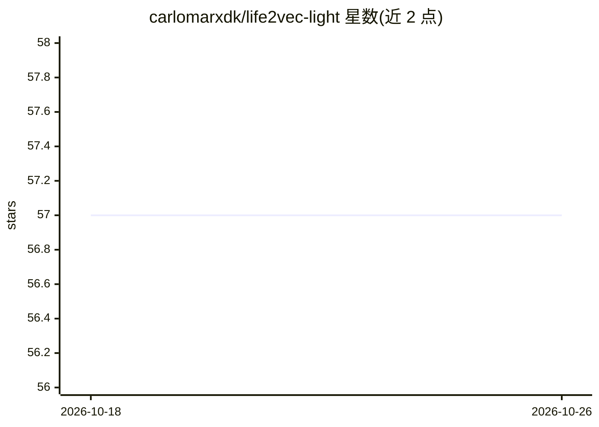

# carlomarxdk/life2vec-light

⭐ 57 · Python · MIT · 推送 2026-04-03 · [GitHub](https://github.com/carlomarxdk/life2vec-light) · [官网](https://life2vec.dk) · 个人维护

**life2vec 生命轨迹 Transformer 模型的轻量实现与示例**

life2vec 论文（Using Sequences of Life-events to Predict Human Lives）模型 backbone 的基础实现，附 dummy 数据。提供 simple_workflow.ipynb 单数据集工作流和 workflow_with_two_datasets.ipynb 多数据集示例，用 misc/synthetic_data.ipynb 生成合成用户/劳动/健康数据；依赖以 requirements.txt 指定，已移除 conda 依赖。相比原实现缺少日志、可视化、实验代码与论文中的损失/指标函数。

## 筛选速览

| 维度 | 判定 | 备注 |
|---|---|---|
| AI 角色 | `ai-native` | 本体是模型或模型工具 |
| 许可风险 | `permissive` | MIT |
| 部署形态 | `None` |  |
| 模型依赖 | — | README 未给出锁定关系 |
| 硬件要求 | — | 无带数字的原话,不猜 |
| 安装摩擦 | `low` | 无编译、无系统依赖或容器化 |
| 成熟度 | — | 结构信号不足 |

## 能力要点

- 仅含模型 backbone，便于按需扩展
- 两个 Jupyter notebook 提供单/双数据集分步工作流
- 合成数据生成脚本（用户库、劳动、健康数据集）
- 数据预处理管线拆分为独立包 tab2seq

## 适用场景

- 在自有表格数据上复现/扩展 life2vec 模型结构
- 学习生命事件序列的 Transformer 表示方法
- 用合成数据跑通训练流程原型

## 场景标签

 · 领域:科研/机器学习

## 证据(README 行号)

> L4: Basic implementation of the `life2vec` model with the dummy data.
> L11: The code here contains only the model's backbone. Thus, you can easily extend it for your specific use.

## 星数曲线

2026-10-18 57 → 2026-10-26 57（+0）

---
*卡片 v1 · prompt 1.4 · 生成 2026-10-24 · 置信度 high · 依据 README sha `e16514865c39` · [字段定义](../../DATASET.md)*
