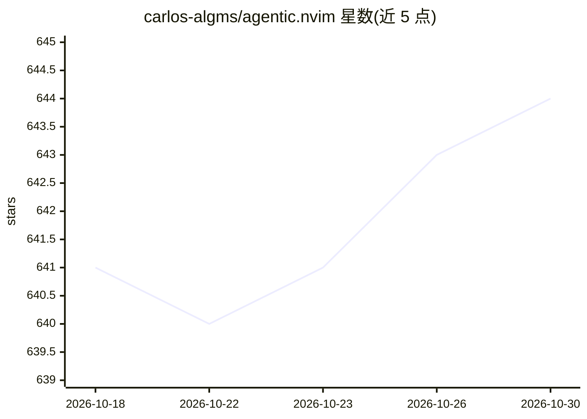

# carlos-algms/agentic.nvim

⭐ 644 · Lua · MIT · 推送 2026-10-16 · [GitHub](https://github.com/carlos-algms/agentic.nvim) · 个人维护

**Neovim 中的 AI agent 聊天界面，经 ACP 接入多家 CLI 编程 agent**

Neovim 插件，通过实现 Agent Client Protocol (ACP) 为 AI 编程 agent 提供聊天界面：支持 Claude、Gemini、Codex、OpenCode、Cursor Agent、Copilot、Auggie、Mistral Vibe、Cline、Goose、Kiro、Pi 等任何 ACP 兼容 provider 的 CLI。复用终端中已有的配置与认证（无需 API key），会话可在 Neovim 与终端之间互通。功能含模型/提供方切换、多会话、工具调用审批、diff 预览、图片粘贴、@ 文件补全等。要求 Neovim v0.11.0+，需手动安装 provider CLI（插件不代管二进制）。

## 筛选速览

| 维度 | 判定 | 备注 |
|---|---|---|
| AI 角色 | `ai-ecosystem` | LLM/agent 周边工具 |
| 许可风险 | `permissive` | MIT |
| 部署形态 | `desktop` | 安装包/桌面程序 |
| 模型依赖 | — | README 未给出锁定关系 |
| 硬件要求 | — | 无带数字的原话,不猜 |
| 安装摩擦 | `low` | 无编译、无系统依赖或容器化 |
| 成熟度 | — | 结构信号不足 |

## 能力要点

- 通过 ACP 接入任意兼容 provider 的 CLI，复用已有配置与认证
- 会话可在 Neovim 与终端之间互通恢复
- 工具调用审批流程与 side-by-side/inline diff 预览
- 多会话并行、模型与 provider 中途切换

## 适用场景

- 在 Neovim 内直接与 Claude/Codex/Gemini 等 CLI agent 对话
- 编辑代码时通过 AI agent 修改文件并逐项审批工具调用
- 在不同 AI 编程 agent 间切换而保留聊天记录

## 场景标签

`编码 Agent` · 领域:编码与开发

## 证据(README 行号)

> L7: > ⚡ A Chat interface for AI agents in Neovim that works with any provider
> L12: **Agentic.nvim** brings your AI assistant to Neovim through the implementation
> L18: Agentic.nvim is the interface, your agent is the Brain. This plugin will use all

## 星数曲线

2026-10-18 641 → 2026-10-30 644（+3）

---
*卡片 v1 · prompt 1.4 · 生成 2026-10-21 · 置信度 mid · 依据 README sha `1b00aace21ea` · [字段定义](../../DATASET.md)*
