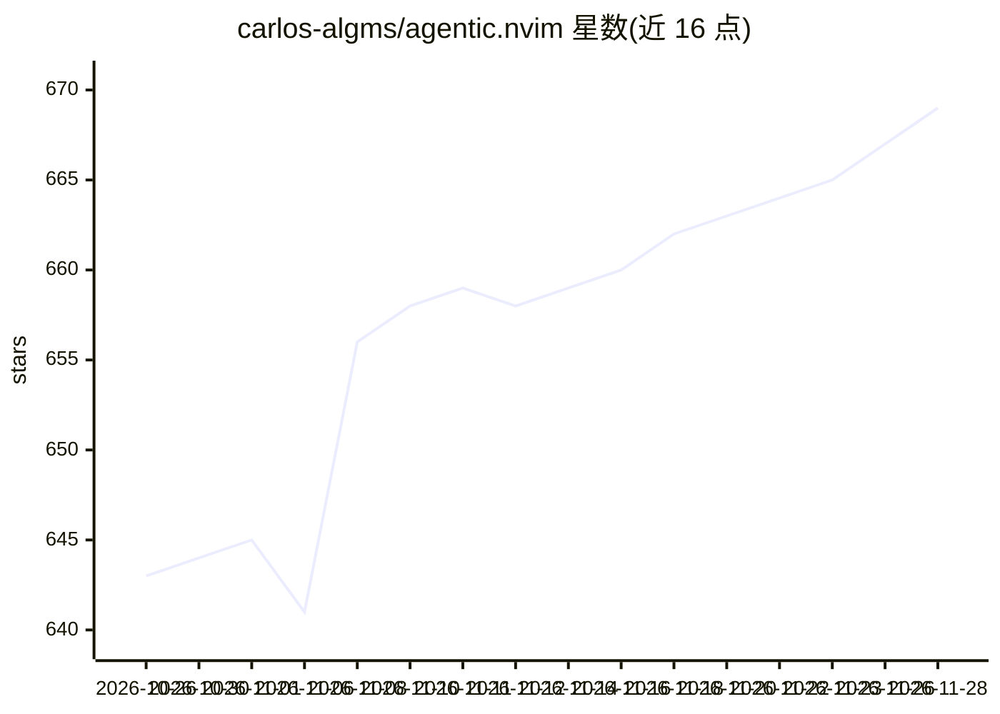

# carlos-algms/agentic.nvim

⭐ 669 · Lua · MIT · 推送 2026-11-08 · [GitHub](https://github.com/carlos-algms/agentic.nvim) · 个人维护

**Neovim 内的 AI Agent 聊天界面，经 ACP 接入多家提供商**

一个 Neovim 插件，通过实现 Agent Client Protocol（ACP）在编辑器内提供与 AI 编码代理对话的聊天界面。插件本身不包含模型，作为接口连接用户已安装的 ACP 提供商 CLI（Claude、Gemini、Codex、OpenCode、Cursor Agent 等），复用终端已有的登录认证、MCP 服务器、skills 与子代理配置。支持会话在 Neovim 与终端间互相恢复、中途切换提供商与模型、工具调用审批、图片粘贴、@文件引用与斜杠命令补全。要求 Neovim ≥0.11 并自行安装所选提供商 CLI。

## 筛选速览

| 维度 | 判定 | 备注 |
|---|---|---|
| AI 角色 | `ai-ecosystem` | LLM/agent 周边工具 |
| 许可风险 | `permissive` | MIT |
| 部署形态 | `desktop` | 安装包/桌面程序 |
| 模型依赖 | locked-api |  |
| 硬件要求 | — | 无带数字的原话,不猜 |
| 安装摩擦 | `low` | 无编译、无系统依赖或容器化 |
| 成熟度 | — | 结构信号不足 |

## 能力要点

- 通过 ACP 协议接入任意兼容提供商，无需 API key，复用终端登录态
- 会话可跨 Neovim 与终端互换恢复
- 工具调用交互审批与 diff 预览、多会话并行运行
- @文件引用、斜杠命令补全、图片拖拽/粘贴进对话

## 适用场景

- 在 Neovim 内与 Claude/Codex 等 AI 代理对话完成代码修改
- 把已在终端使用的 AI 代理配置与登录直接带入编辑器
- 同一任务在终端与 Neovim 间延续会话
- 并排查看 AI 编辑文件的 diff 并一键批准工具调用

## 场景标签

`编码 Agent` · 领域:编码与开发

## 证据(README 行号)

> L12: **Agentic.nvim** brings your AI assistant to Neovim through the implementation
> L18: Agentic.nvim is the interface, your agent is the Brain. This plugin will use all
> L34: Works with **any** AI provider that implements the

## 星数曲线

2026-10-26 643 → 2026-11-28 669（+26）

---
*卡片 v1 · prompt 1.4 · 生成 2026-11-24 · 置信度 mid · 依据 README sha `89275b642162` · [字段定义](../../DATASET.md)*
