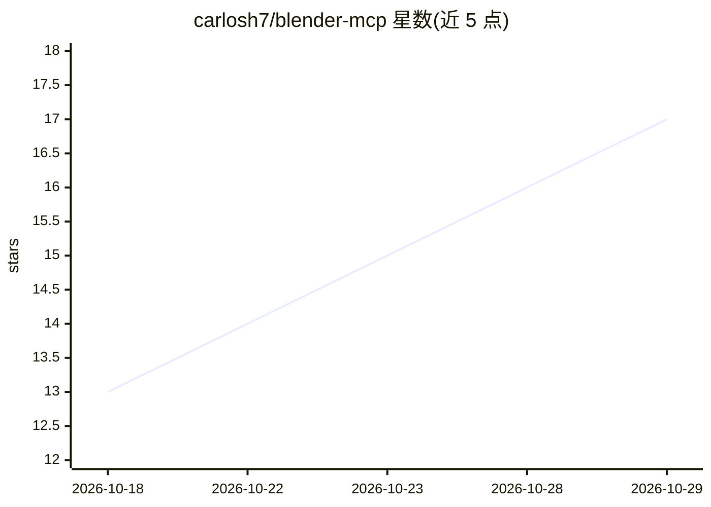

# carlosh7/blender-mcp

⭐ 17 · Python · MIT · 推送 2026-08-29 · [GitHub](https://github.com/carlosh7/blender-mcp) · [官网](https://github.com/carlosh7/blender-mcp/releases/latest) · 个人维护

**让 AI agent 用自然语言操控 Blender 建模渲染的 MCP 服务器**

通过 Model Context Protocol 将 Blender 连接到 LLM agent 的 MCP 服务器与 Blender 插件组合：提供 248 个类型化工具，覆盖建模、PBR 材质、几何节点、灯光、动画、物理、渲染（Cycles/EEVEE）、FBX/OBJ/glTF/STL 导出等；支持 stdio/SSE/HTTP 接入 Claude Code、Cursor、opencode 等任意 MCP 客户端。含 VLM 视觉反馈循环（agent 查看渲染结果迭代）、AST 代码黑名单、本地回环+令牌认证与限速等安全机制。要求 Blender 4.2+ 与 Python 3.10+，交互模式需 Blender 保持开启。

## 筛选速览

| 维度 | 判定 | 备注 |
|---|---|---|
| AI 角色 | `ai-ecosystem` | LLM/agent 周边工具 |
| 许可风险 | `permissive` | MIT |
| 部署形态 | `desktop` | 安装包/桌面程序 |
| 模型依赖 | local-ok | 支持本地模型 |
| 硬件要求 | — | 无带数字的原话,不猜 |
| 安装摩擦 | `low` | 无编译、无系统依赖或容器化 |
| 成熟度 | — | 结构信号不足 |

## 能力要点

- 248 个 MCP 工具覆盖建模/材质/动画/物理/渲染/导出
- 支持 stdio/SSE/HTTP 任意 MCP 客户端接入
- VLM 反馈循环：agent 捕获并分析渲染结果后迭代
- AST 代码黑名单、localhost+令牌认证、限速等安全机制

## 适用场景

- 用对话让 Claude 等 agent 直接在 Blender 里建模和渲染
- 批量 3D 资产制作与多 agent 协作场景规划
- headless CI 中自动渲染与端到端 3D 流水线

## 场景标签

`GUI 自动化` · 领域:效率与自动化

## 证据(README 行号)

> L10: **The most complete MCP server for Blender** — control Blender with natural language from any AI agent: Claude Code
> L29: `blender-mcp-ultra` connects **Blender** (the free open-source 3D suite) to **LLM agents** through the **Model Cont
> L39: - 🧰 **248 MCP tools** (7 base + 241 registry, incl. built-in workflow guidance) — modeling, materials, shader nodes

## 星数曲线

2026-10-18 13 → 2026-10-29 17（+4）

---
*卡片 v1 · prompt 1.4 · 生成 2026-10-29 · 置信度 high · 依据 README sha `ef1d6d3a44cc` · [字段定义](../../DATASET.md)*
