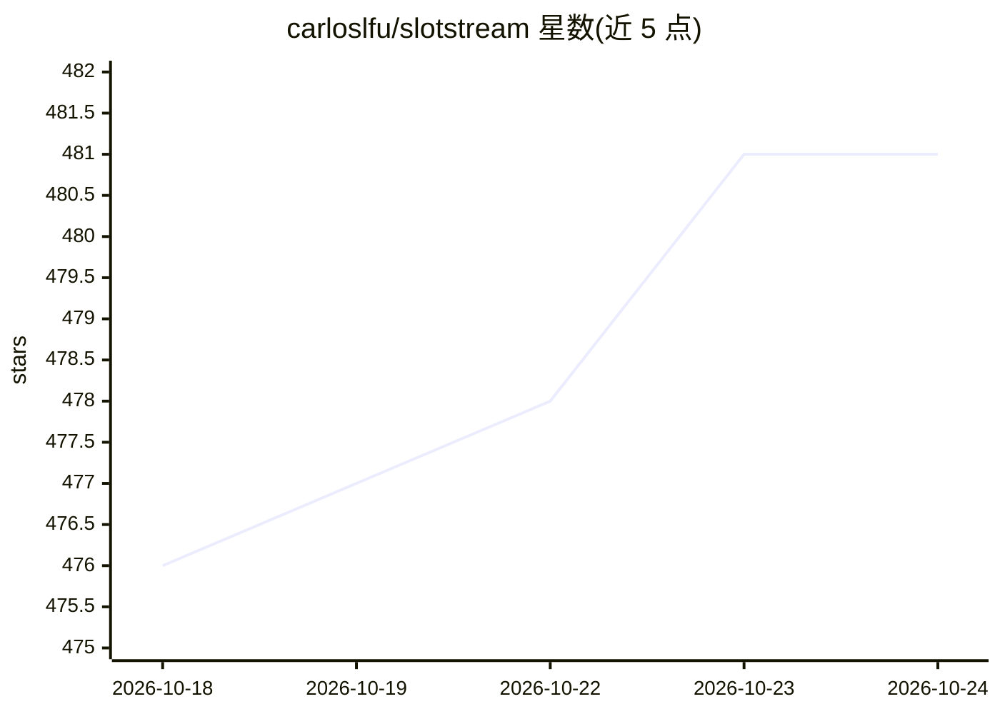

# carloslfu/slotstream

⭐ 483 · Swift · MIT · 推送 2026-10-23 · [GitHub](https://github.com/carloslfu/slotstream) · 个人维护

**在内存装不下 105GB 模型的 Mac 上流式运行本地大模型**

面向 16–64 GB 内存的 Apple Silicon Mac 的本地推理引擎：将 Qwen3.8-Flash-Next（125B MoE，4-bit 约 105 GB）的主体留在 SSD，共享权重驻留内存，按需读取专家网络并缓存高频专家，配合专家预读与自动内存规划（Auto mode 选定内存目标、上下文窗口与投机解码）。整体为单一 Swift 原生程序，基于 MLX 与 Metal，无 Python 运行时，下载一次模型后离线运行。提供 Ollama/OpenAI/Anthropic 兼容 API 与 Swift 库，可用 slotstream launch 一键拉起 Claude Code、Codex 等编码 agent。限制：仅支持 Apple Silicon 与 macOS 14+，需约 110 GB SSD；一次仅一个生成任务；长上下文首读耗时以分钟计。

## 筛选速览

| 维度 | 判定 | 备注 |
|---|---|---|
| AI 角色 | `ai-ecosystem` | LLM/agent 周边工具 |
| 许可风险 | `permissive` | MIT |
| 部署形态 | `None` |  |
| 模型依赖 | local-ok | 支持本地模型 |
| 硬件要求 | — | 无带数字的原话,不猜 |
| 安装摩擦 | `low` | 无编译、无系统依赖或容器化 |
| 成熟度 | — | 结构信号不足 |

## 能力要点

- MoE 专家按需从 SSD 流式加载并缓存高频专家至内存
- 单一 Swift 原生二进制，基于 MLX/Metal，自带编译的 Metal kernel，无 Python
- Ollama/OpenAI/Anthropic 兼容 API 与 Swift 库供应用接入
- Auto mode 按机器内存自动选定内存目标、上下文窗口（最高 262,144 tokens）与投机解码

## 适用场景

- 在 16–64 GB 内存的 Mac 上本地运行 125B 参数的大模型
- 通过 Claude Code、Codex、opencode 等编码 agent 使用本地模型写代码
- 用 Open WebUI 等聊天应用连接本地模型对话或识图
- 离线、无云端账号地在本地做大模型推理

## 场景标签

`推理引擎` · 领域:训练与推理

## 证据(README 行号)

> L16: starts Claude Code on the local model, and Codex, Pi, opencode and Hermes work
> L17: the same way. Developers can connect their own apps through its Ollama-,
> L18: OpenAI- and Anthropic-compatible APIs or its Swift library.
> L201: Slotstream runs the model. Keep its server running while a connected app uses it.
> L202: `slotstream launch claude` (or `codex`, `pi`, `opencode`, `hermes`) starts

## 星数曲线

2026-10-18 476 → 2026-10-24 481（+5）

---
*卡片 v1 · prompt 1.4 · 生成 2026-10-21 · 置信度 high · 依据 README sha `163851f3462e` · [字段定义](../../DATASET.md)*
