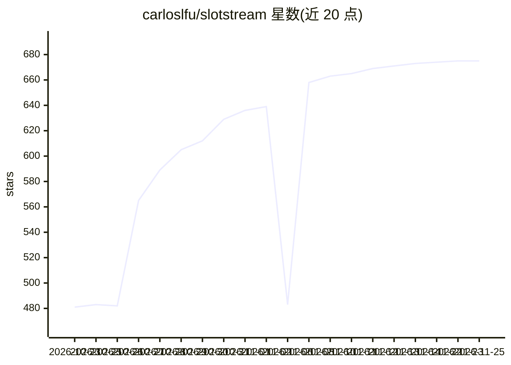

# carloslfu/slotstream

⭐ 675 · Swift · MIT · 推送 2026-11-17 · [GitHub](https://github.com/carloslfu/slotstream) · 个人维护

**在内存不足的 Apple Silicon Mac 上从 SSD 流式运行 105GB 大模型**

面向 16–64 GB 内存的 Apple Silicon Mac 的本地推理引擎：通过 mixture-of-experts 架构把 Qwen3.8-Flash-Next 4-bit 模型的专家权重按需从 SSD 读取进 RAM 缓存，共享权重常驻内存，自动模式按机器选择内存预算与上下文窗口。全 Swift 实现，基于 MLX 和 Metal，无 Python 运行时，模型下载后可离线推理。提供 CLI、兼容 Ollama/OpenAI/Anthropic 的 API 和 Swift 库，可接入 Claude Code、Codex 等编码 agent。限制：仅维护单一模型检查点，一次只支持一个生成请求。

## 筛选速览

| 维度 | 判定 | 备注 |
|---|---|---|
| AI 角色 | `ai-ecosystem` | LLM/agent 周边工具 |
| 许可风险 | `permissive` | MIT |
| 部署形态 | `None` |  |
| 模型依赖 | local-ok | 支持本地模型 |
| 硬件要求 | — | 无带数字的原话,不猜 |
| 安装摩擦 | `low` | 无编译、无系统依赖或容器化 |
| 成熟度 | — | 结构信号不足 |

## 能力要点

- MoE 专家按需从 SSD 流式读取并 RAM 缓存，125B 模型跑进 16–64 GB 内存
- 纯 Swift + MLX/Metal 原生实现，无 Python，离线推理
- 提供 Ollama/OpenAI/Anthropic 兼容 API、CLI 与 Swift 库
- 一条命令接入 Claude Code/Codex/Pi/opencode/Hermes 等编码 agent

## 适用场景

- 在小内存 Apple Silicon Mac 上离线运行超大开源模型
- 把本地模型作为 Claude Code、Codex 等编码 agent 的后端
- 通过兼容 API 用 Open WebUI 等聊天应用连接本地模型

## 场景标签

`推理引擎` · 领域:训练与推理

## 证据(README 行号)

> L10: memory**. It streams experts from SSD and caches them in RAM. The engine is
> L14: Chat, ask about pictures, or connect a coding agent. Slotstream provides a
> L15: CLI, Ollama-, OpenAI- and Anthropic-compatible APIs, and a Swift library.

## 星数曲线

2026-10-23 481 → 2026-11-25 675（+194）

---
*卡片 v1 · prompt 1.4 · 生成 2026-11-24 · 置信度 high · 依据 README sha `566af9b351bb` · [字段定义](../../DATASET.md)*
