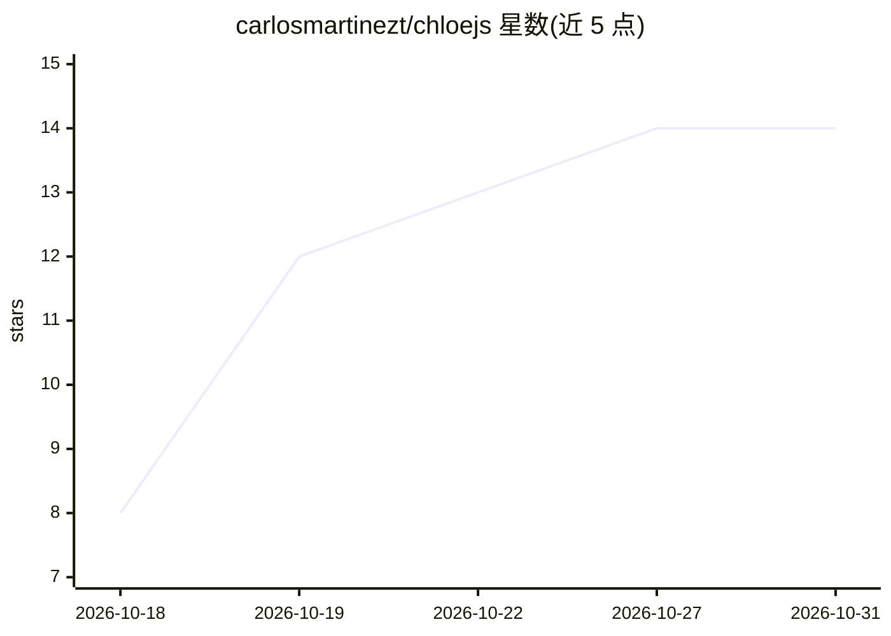

# carlosmartinezt/chloejs

⭐ 14 · TypeScript · MIT · 推送 2026-10-28 · [GitHub](https://github.com/carlosmartinezt/chloejs) · [官网](https://chloejs.org) · 个人维护

**本地运行的 TypeScript AI agent 运行时：代码主导、按需调用 LLM**

Chloe 是运行在用户自己机器上的 Node.js agent 运行时：agent 以 TypeScript 代码编写，规则、循环与查询留在代码中，仅在需要判断的步骤调用 LLM（step/model/agent/ask 四级原语）。支持 cron 定时、聊天触发或手动运行，通过 Telegram/Slack/Discord/WhatsApp/邮件等渠道交互；状态存于单进程与一个 SQLite 文件，每步的输入、回答与成本有记录，可重放。模型经 AI SDK 接任意 provider，支持订阅或 API key 付费。限制：需 Node 22.18+，单机单副本，不面向多机或托管平台。

## 筛选速览

| 维度 | 判定 | 备注 |
|---|---|---|
| AI 角色 | `ai-ecosystem` | LLM/agent 周边工具 |
| 许可风险 | `permissive` | MIT |
| 部署形态 | `library` | 以包/库形式分发 |
| 模型依赖 | — | README 未给出锁定关系 |
| 硬件要求 | — | 无带数字的原话,不猜 |
| 安装摩擦 | `low` | 无编译、无系统依赖或容器化 |
| 成熟度 | — | 结构信号不足 |

## 能力要点

- step/model/agent/ask 四级调用原语，代码决定是否调用模型
- 持久化 job：完成的步骤在恢复时重放，等待人工审批可跨重启存活数天
- 任意 provider 任意模型（经 AI SDK），支持订阅优先于 key 计费
- 运行记录含每步输入、回答与成本；agent 自修改以 git commit 记录可回退

## 适用场景

- 写代码定义个人助理：晨报、价格监控、账单提醒等定时任务
- 构建需要人工审批与预算控制的业务 agent（如付款流程）
- 在本地单进程内运行可审计、可回放的 agent 任务

## 场景标签

`Agent 框架` · 领域:Agent 开发

## 证据(README 行号)

> L9: Chloe runs your AI agents on your own machine. The work is plain code, and an
> L144: |Any model|Any provider, a model per job, on a subscription or a key.|
> L83: export default defineJob({

## 星数曲线

2026-10-18 8 → 2026-10-31 14（+6）

---
*卡片 v1 · prompt 1.4 · 生成 2026-10-31 · 置信度 high · 依据 README sha `f1c9f4cd315a` · [字段定义](../../DATASET.md)*
