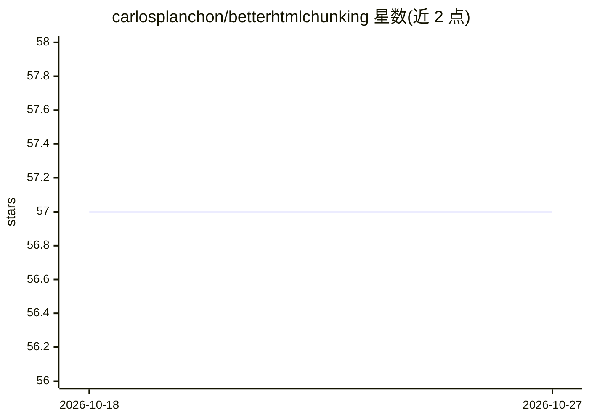

# carlosplanchon/betterhtmlchunking

⭐ 57 · Python · MIT · 推送 2026-07-05 · [GitHub](https://github.com/carlosplanchon/betterhtmlchunking) · 个人维护

**基于 DOM 树分析的 HTML 分块 Python 库**

Python 库，读取原始 HTML 构建 DOM 树表示，用 BFS 遍历检测内容密集的兴趣区域，按文本或 HTML 长度限制合并节点生成分块，保留父子层级关系与位置 XPath。输出 HTML 与纯文本两种分块格式，支持自定义标签过滤（如 script/style）。随包附带 Typer 构建的 CLI，可从 stdin 管道读取，输出单块、全部块、纯文本或结构化 JSON。面向 LLM 处理场景下的 HTML 结构化切分，README 说明可与 LangChain 的文本分块组合使用。

## 筛选速览

| 维度 | 判定 | 备注 |
|---|---|---|
| AI 角色 | `ai-ecosystem` | LLM/agent 周边工具 |
| 许可风险 | `permissive` | MIT |
| 部署形态 | `library` | 以包/库形式分发 |
| 模型依赖 | — | README 未给出锁定关系 |
| 硬件要求 | — | 无带数字的原话,不猜 |
| 安装摩擦 | `low` | 无编译、无系统依赖或容器化 |
| 成熟度 | — | 结构信号不足 |

## 能力要点

- DOM 树 BFS 遍历与兴趣区域检测决定分块边界
- 可按 HTML 长度或渲染文本长度限制分块大小
- 输出 HTML/纯文本双格式，分块带位置 XPath
- 附带 CLI：管道输入、JSON 输出、块列表与详细日志

## 适用场景

- 对网页 HTML 做结构感知切分后再送入 LLM 处理
- 保留标题与嵌套层级关系的语义分块
- 过滤 script/style 等标签后提取正文内容
- 在脚本或 nushell 管道中程序化处理分块 JSON 输出

## 场景标签

`文档解析` · 领域:知识与检索

## 证据(README 行号)

> L12: A Python library for intelligently chunking HTML documents into structured, size-limited segments based on DOM tree
> L111: You can even combine the two techniques if you need both **structured extraction** (via betterhtmlchunking) and **

## 星数曲线

2026-10-18 57 → 2026-10-27 57（+0）

---
*卡片 v1 · prompt 1.4 · 生成 2026-10-24 · 置信度 high · 依据 README sha `e0f005b19481` · [字段定义](../../DATASET.md)*
