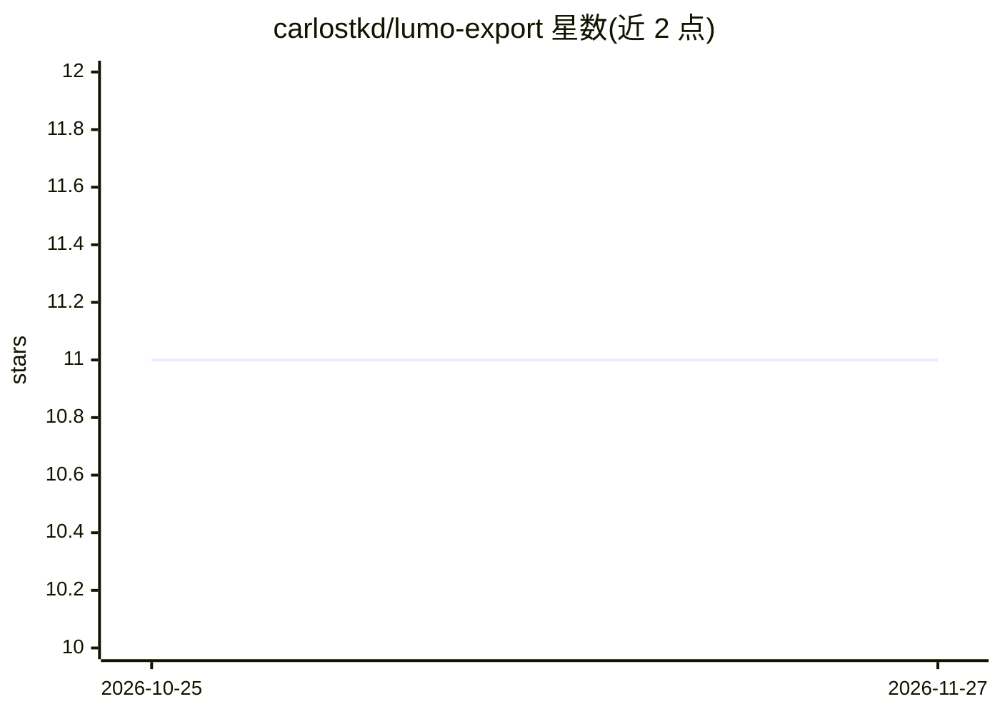

# carlostkd/lumo-export

⭐ 11 · JavaScript · MIT · 推送 2026-10-12 · [GitHub](https://github.com/carlostkd/lumo-export) · [官网](https://carlostkd.ch/lumo/export) · 个人维护

**Firefox 扩展：一键导出 Lumo 聊天记录为多格式**

面向 Proton Lumo 用户的浏览器扩展，补足其界面缺少的会话导出功能：一键将聊天历史保存为 JSON、纯文本、HTML 或 Markdown，支持全选/按角色/手动勾选的筛选导出，可剥离 UI 元素与元数据，导出前支持查找替换匿名化。附带 AES-256 密码加密归档、代码块提取、实时搜索与本地自定义回复库。全部处理在浏览器本地完成，声明不向任何服务器发送数据，需 Firefox 140 及以上。

## 筛选速览

| 维度 | 判定 | 备注 |
|---|---|---|
| AI 角色 | `ai-enhanced` | 去掉 AI 部分产品仍成立 |
| 许可风险 | `permissive` | MIT |
| 部署形态 | `None` |  |
| 模型依赖 | — | README 未给出锁定关系 |
| 硬件要求 | — | 无带数字的原话,不猜 |
| 安装摩擦 | `low` | 无编译、无系统依赖或容器化 |
| 成熟度 | — | 结构信号不足 |

## 能力要点

- 一键导出为 JSON/TXT/HTML/Markdown 四种格式
- AES-256 密码加密归档（PBKDF2 + AES-GCM）
- 代码块提取器可将全部代码片段导出为 Markdown 或文本文件
- 导出前查找替换支持内容匿名化

## 适用场景

- 把 Lumo 聊天记录归档为 HTML 长期保存
- 将对话以结构化 JSON 导入数据库或做自定义分析
- 导出前替换敏感词进行匿名化处理

## 场景标签

 · 领域:浏览器扩展/数据导出工具

## 证据(README 行号)

> L29: **Lumo Chat Export** is a Firefox extension that fills a critical gap in Proton's Lumo interface the ability to exp
> L67: |💡 **Smart & Custom Replies**|Access a curated library of predefined technical prompts or create your own saved res
> L144: - ✅ Does **NOT** collect any user data

## 星数曲线

2026-10-25 11 → 2026-11-27 11（+0）

---
*卡片 v1 · prompt 1.4 · 生成 2026-11-18 · 置信度 high · 依据 README sha `cbcf3273d50f` · [字段定义](../../DATASET.md)*
