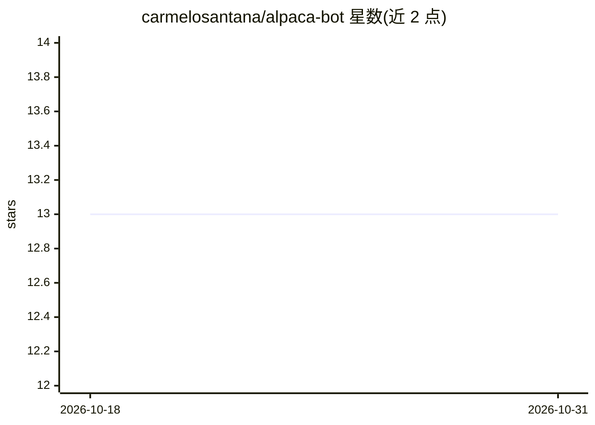

# carmelosantana/alpaca-bot

⭐ 13 · PHP · GPL-2.0 · 推送 2026-09-30 · [GitHub](https://github.com/carmelosantana/alpaca-bot) · [官网](https://alpaca.bot) · 个人维护

**WordPress 后台私有 AI 聊天插件：对接自托管模型**

WordPress 插件，在 wp-admin 内提供聊天屏幕、抽屉与区块编辑器侧栏，连接用户自托管的模型端点（默认 Ollama，或任何 OpenAI 兼容端点）。对话存储在站点自身数据库中且仅作者可见，也可关闭存储。支持每会话切换模型、流式回复、按回复的模型/token/耗时回执、站点与用户级月度用量上限、模型可调用的工具（抓网页/摘要/写草稿/WordPress abilities）及远程 MCP 服务器，权限按 capability 逐行控制。需要 PHP 8.4+、WordPress 6.9+ 与 Ollama 实例。

## 筛选速览

| 维度 | 判定 | 备注 |
|---|---|---|
| AI 角色 | `ai-native` | 本体是模型或模型工具 |
| 许可风险 | `viral` | GPL-2.0 |
| 部署形态 | `desktop` | 安装包/桌面程序 |
| 模型依赖 | local-ok | 支持本地模型 |
| 硬件要求 | — | 无带数字的原话,不猜 |
| 安装摩擦 | `low` | 无编译、无系统依赖或容器化 |
| 成熟度 | — | 结构信号不足 |

## 能力要点

- wp-admin 聊天屏幕、抽屉与区块编辑器侧栏三种入口，回复流式输出
- 对话私有存储于站点数据库，隐私选项可完全不存储
- 模型可调用工具（web_fetch/summarize/draft_post/abilities）与远程 MCP 服务器，逐项开关并按 capability 控制访问
- 站点级与用户级月度 token 用量上限

## 适用场景

- 在我的 WordPress 站点内与自托管模型对话，数据不出站
- 让模型代为抓取网页、总结内容并起草文章
- 按角色控制谁能用聊天、工具与 MCP 服务器

## 场景标签

`聊天机器人` `AI 写作` `网页抓取` · 领域:效率与自动化

## 证据(README 行号)

> L17: **Alpaca Bot** is a chat screen inside WordPress admin, talking to a model you host. Conversations stay on your sit
> L21: - A chat screen in wp-admin: replies stream in as they are written, with a copy button on every message and code bl
> L27: - Tools the model can call, each switchable: fetch a web page, summarize, write a draft, and the abilities tool, wh

## 星数曲线

2026-10-18 13 → 2026-10-31 13（+0）

---
*卡片 v1 · prompt 1.4 · 生成 2026-10-31 · 置信度 mid · 依据 README sha `2941d9a3cd2c` · [字段定义](../../DATASET.md)*
