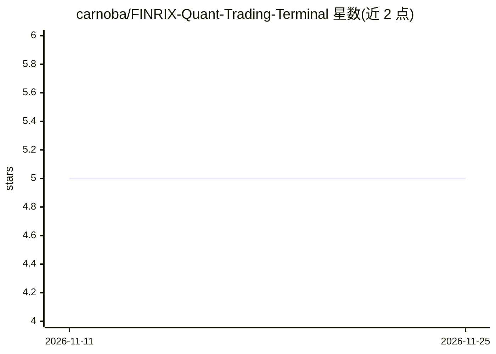

# carnoba/FINRIX-Quant-Trading-Terminal

⭐ 5 · Python · MIT · 推送 2026-11-13 · [GitHub](https://github.com/carnoba/FINRIX-Quant-Trading-Terminal) · 个人维护

**面向 XAUUSD 黄金的量化交易研究终端与 TFT 预测引擎**

以 CLI/PyQt 形式交付的量化研究终端，围绕 XAUUSD 黄金提供分位数价格走廊预测（日/月/年三个时间尺度）、基于逐笔成交的回测引擎（含点差、滑点、止损止盈退出模拟）、14 种策略的参数化回测与风险仓位计算（Kelly 分配、动态权益复利）。执行路径分本地 CPU 基线与 Modal A10G 云端 GPU 两条（TFT 深度学习与 CUDA 蒙特卡洛走云端）；宏观情绪用 FinBERT 处理 RSS 标题。定位为研究原型，需另行安装券商桥并授权才会执行实盘订单。

## 筛选速览

| 维度 | 判定 | 备注 |
|---|---|---|
| AI 角色 | `ai-native` | 本体是模型或模型工具 |
| 许可风险 | `permissive` | MIT |
| 部署形态 | `library` | 以包/库形式分发 |
| 模型依赖 | — | README 未给出锁定关系 |
| 硬件要求 | — | 无带数字的原话,不猜 |
| 安装摩擦 | `medium` | 含编译或系统依赖之一 |
| 成熟度 | `idea` | |

## 能力要点

- 双路径执行：本地 CPU 基线 / Modal A10G 云 GPU（TFT、CUDA 蒙特卡洛）
- 逐笔成交回测：模拟信号入场、持仓跟踪、点差与滑点
- 14 种策略的参数化回测引擎与参数持久化
- FinBERT 处理 RSS 宏观新闻，带正则回退路径

## 适用场景

- 研究黄金价格的多周期分位数预测走廊
- 对 14 种技术指标策略做含交易成本的回测
- 按账户权益与风险百分比计算仓位与止损止盈
- 聚合宏观新闻并生成鹰鸽情绪评分

## 场景标签

`金融量化` · 领域:学习与行业

## 证据(README 行号)

> L26: `pip install finrix` installs the complete XAUUSD quantitative forecasting terminal, including local CPU baseline e
> L51: - **Modal A10G Cloud GPU** -- NeuralForecast TFT deep learning, 100,000-path CUDA Monte Carlo, CUDA-accelerated qua
> L88: |TFT Log-Return Trend|Temporal Fusion Transformer ML|

## 星数曲线

2026-11-11 5 → 2026-11-25 5（+0）

---
*卡片 v1 · prompt 1.4 · 生成 2026-11-21 · 置信度 high · 依据 README sha `b69ff95d5ebf` · [字段定义](../../DATASET.md)*
