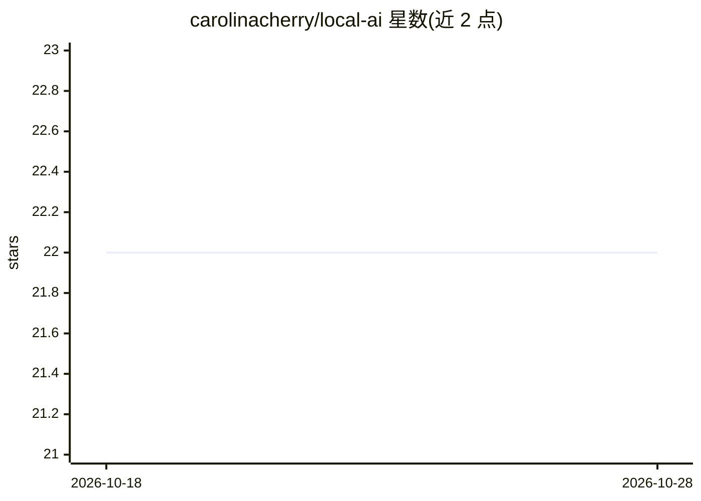

# carolinacherry/local-ai

⭐ 22 · Swift · MIT · 推送 2026-03-14 · [GitHub](https://github.com/carolinacherry/local-ai) · 个人维护

**在 iPhone 上离线运行 Qwen3.5 对话的应用，零云端**

用 Swift/SwiftUI 编写的 iOS 应用，通过 Apple MLX 在设备本地运行 4-bit 量化的 Qwen3.5 系列模型（0.8B/2B/4B/9B），从 Hugging Face 下载，无服务器组件、无需 API key。功能包括对话持久化、模型切换与下载管理、iOS 端内语音识别输入、可选的 Brave Search 联网搜索（key 存 Keychain）、Markdown 渲染与 tok/s 统计。要求 iPhone 15 Pro 及以上、iOS 17+、约 3 GB 存储空间，需自行用 Xcode 构建安装。

## 筛选速览

| 维度 | 判定 | 备注 |
|---|---|---|
| AI 角色 | `ai-native` | 本体是模型或模型工具 |
| 许可风险 | `permissive` | MIT |
| 部署形态 | `None` |  |
| 模型依赖 | — | README 未给出锁定关系 |
| 硬件要求 | — | 无带数字的原话,不猜 |
| 安装摩擦 | `low` | 无编译、无系统依赖或容器化 |
| 成熟度 | — | 结构信号不足 |

## 能力要点

- 基于 MLX Swift 的 100% 设备端推理，零服务器组件
- 支持 Qwen3.5 0.8B–9B 四档模型切换与下载管理
- iOS Speech framework 端内语音输入
- 可选 Brave Search 联网搜索，自动预取新数据

## 适用场景

- 在无网络的 iPhone 上与本地大模型对话
- 隐私敏感场景下使用不离开设备的 AI 助手
- 通过自建侧载体验端侧 LLM 的速度与质量

## 场景标签

`AI 助手` `聊天机器人` · 领域:对话与助手

## 证据(README 行号)

> L3: Run Qwen3.5 entirely on your iPhone. No cloud. No API keys. No subscriptions.
> L30: - 100% on-device inference via Apple MLX
> L81: |Inference|MLX Swift (`ml-explore/mlx-swift-lm`)|

## 星数曲线

2026-10-18 22 → 2026-10-28 22（+0）

---
*卡片 v1 · prompt 1.4 · 生成 2026-10-27 · 置信度 high · 依据 README sha `d667a62eae25` · [字段定义](../../DATASET.md)*
