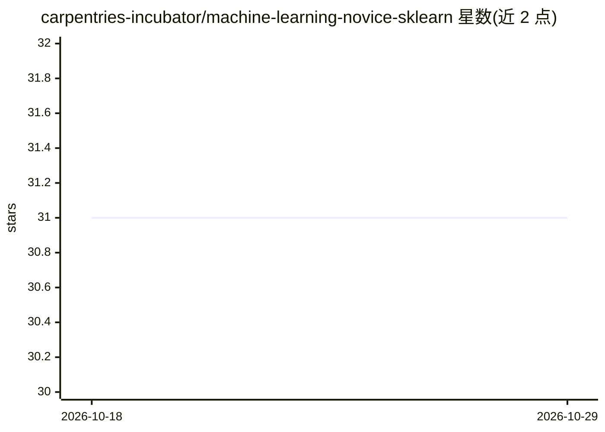

# carpentries-incubator/machine-learning-novice-sklearn

⭐ 31 · Jupyter Notebook · NOASSERTION · 推送 2026-10-27 · [GitHub](https://github.com/carpentries-incubator/machine-learning-novice-sklearn) · [官网](https://carpentries-incubator.github.io/machine-learning-novice-sklearn/) · 组织维护

**面向新手的 scikit-learn 机器学习课程（Carpentries 教学风格）**

Carpentries 风格的英文机器学习入门课程，内容覆盖回归、分类、集成方法、聚类、降维、神经网络与伦理等主题，面向无编程或机器学习背景的学习者。仓库通过 Carpentries 模板生成课程网站，学习者可通过 MyBinder 在浏览器中运行配好环境的 JupyterLab 实例，无需本地安装软件；README 提示 MyBinder 计算能力有限，部分示例运行较慢。由 Colin Sauze 与 Vini Salazar 维护，处于 incubator 阶段。

## 筛选速览

| 维度 | 判定 | 备注 |
|---|---|---|
| AI 角色 | `ai-knowledge` | 知识聚合/清单类 |
| 许可风险 | `none` | NOASSERTION |
| 部署形态 | `None` |  |
| 模型依赖 | — | README 未给出锁定关系 |
| 硬件要求 | — | 无带数字的原话,不猜 |
| 安装摩擦 | `low` | 无编译、无系统依赖或容器化 |
| 成熟度 | — | 结构信号不足 |

## 能力要点

- 课程大纲覆盖回归、分类、集成、聚类、降维、神经网络与伦理
- 支持通过 MyBinder 在线运行 JupyterLab，无需本地安装
- 基于 Carpentries 模板自动生成课程网站

## 适用场景

- 机器学习新手系统学习 scikit-learn 基础概念
- 无本地环境的用户在线跟做课程练习
- 作为 Carpentries 工作坊教学材料

## 场景标签

`教程课程` · 领域:学习与行业

## 证据(README 行号)

> L1: # Introduction to Machine Learning with Scikit Learn and Python
> L20: * Introduction
> L5: If you don't have access to a computer with the software needed for this lesson installed or are not able to install

## 星数曲线

2026-10-18 31 → 2026-10-29 31（+0）

---
*卡片 v1 · prompt 1.4 · 生成 2026-10-26 · 置信度 high · 依据 README sha `e5add0f34a00` · [字段定义](../../DATASET.md)*
