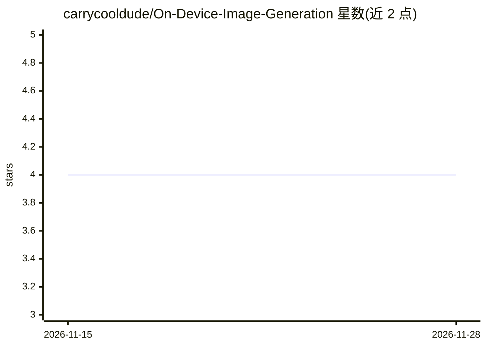

# carrycooldude/On-Device-Image-Generation

⭐ 4 · Kotlin · 推送 2026-11-06 · [GitHub](https://github.com/carrycooldude/On-Device-Image-Generation) · 个人维护

**在骁龙 NPU 上本地运行扩散模型生成图像的 Android 应用**

Android 应用，通过 ONNX Runtime QNN 后端与 Qualcomm QNN Runtime，在 Snapdragon 8 Elite 的 Hexagon NPU 上直接运行 Qualcomm AI Hub 导出的 `precompiled_qnn_onnx`（w8a16 量化）扩散模型，支持 Stable Diffusion v2.1/v1.5 文生图与 ControlNet Canny 边缘引导生成，512×512 分辨率。模型需从 Qualcomm AI Hub 下载后经 adb 推送到设备；应用含内置 CLIP BPE 分词器与调度器，通过 gradlew 从源码构建。目标用户为骁龙旗舰设备的 Android 用户。

## 筛选速览

| 维度 | 判定 | 备注 |
|---|---|---|
| AI 角色 | `ai-native` | 本体是模型或模型工具 |
| 许可风险 | `none` | — |
| 部署形态 | `None` |  |
| 模型依赖 | — | README 未给出锁定关系 |
| 硬件要求 | — | 无带数字的原话,不猜 |
| 安装摩擦 | `low` | 无编译、无系统依赖或容器化 |
| 成熟度 | — | 结构信号不足 |

## 能力要点

- 支持 Stable Diffusion v2.1/v1.5 与 ControlNet Canny 三种 512×512 模型
- Snapdragon 8 Elite Hexagon NPU 硬件加速推理（QNN HTP）
- 内置 CLIP BPE Tokenizer 与 DPM-Solver++/Euler 调度器
- w8a16 uint16 量化/反量化流水线由模型包 metadata.json 驱动

## 适用场景

- 在没有云端服务的手机上本地文生图
- 用 Canny 边缘图引导生成图像
- 在骁龙 8 Elite 设备上体验 NPU 加速的扩散模型推理

## 场景标签

`图像生成` · 领域:内容生成

## 证据(README 行号)

> L3: Minimal Android app running **Qualcomm AI Hub** `precompiled_qnn_onnx` (`w8a16`) diffusion models directly on the **
> L10: - Hardware-accelerated on-device NPU inference via **ONNX Runtime Android QNN (`1.29.0`)** and **Qualcomm QNN Runti

## 星数曲线

2026-11-15 4 → 2026-11-28 4（+0）

---
*卡片 v1 · prompt 1.4 · 生成 2026-11-21 · 置信度 high · 依据 README sha `814db673693e` · [字段定义](../../DATASET.md)*
