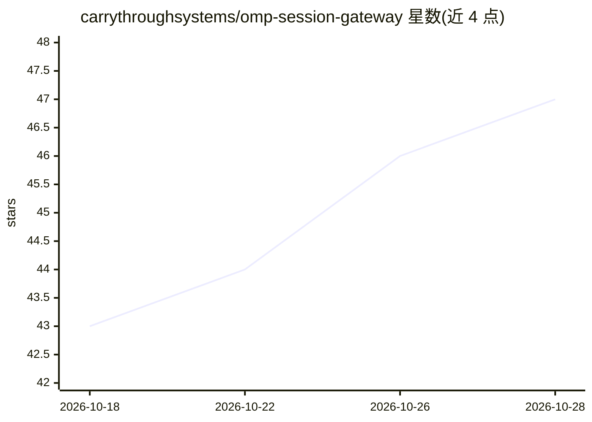

# carrythroughsystems/omp-session-gateway

⭐ 47 · TypeScript · MIT · 推送 2026-10-27 · [GitHub](https://github.com/carrythroughsystems/omp-session-gateway) · [官网](https://carrythroughsystems.github.io/omp-session-gateway/) · 组织维护

**手机浏览器集中查看与进入 OMP 终端会话的私有网关**

面向 Oh My Pi（OMP）终端编码代理用户的会话网关：在主机上运行回环守护进程，每 10 秒自动发现所有启用协作的 omp 进程，在手机 PWA 的 Sessions 目录中列出；当会话等待输入时按 FIFO 推送最旧请求，一键打开 OMP 自带的加密 View/Control 客户端，无需二维码或复制链接。隐私设计上仅通过 Tailscale Serve（TUN 模式）暴露，链接按需取用不存储，无遥测与脚本加载。安装依赖 Bun 1.4.0、OMP 18.1.20+ 与 Tailscale，仅支持单用户工作站。

## 筛选速览

| 维度 | 判定 | 备注 |
|---|---|---|
| AI 角色 | `ai-ecosystem` | LLM/agent 周边工具 |
| 许可风险 | `permissive` | MIT |
| 部署形态 | `None` |  |
| 模型依赖 | — | README 未给出锁定关系 |
| 硬件要求 | — | 无带数字的原话,不猜 |
| 安装摩擦 | `low` | 无编译、无系统依赖或容器化 |
| 成熟度 | — | 结构信号不足 |

## 能力要点

- 每 10 秒自动发现全部协作启用的 omp 会话，无逐会话配置
- Needs you 按最旧请求优先排序，一键打开 OMP 加密 View/Control 客户端
- 回环守护进程 + Tailscale Serve 精确登录白名单，禁用 Funnel
- View/Control 链接仅点击时取用、不落盘，会话失效则拒绝打开

## 适用场景

- 在手机上随时查看终端里多个 OMP 会话的状态
- 会话等待输入时收到提醒并远程批准或查看记录
- 在私有 tailnet 内不依赖公网服务管理编码代理

## 场景标签

 · 领域:开发者工具/编码代理会话管理

## 证据(README 行号)

> L5: Keep using Oh My Pi in your terminal. OMP Session Gateway lists your collaboration-enabled sessions, shows which nee
> L27: 1. **Discover automatically** — Every collaboration-enabled `omp` process appears in **OMP Sessions** on the next 1
> L156: - **Keep work in running `omp` terminals** — **OMP Session Gateway** lists live terminal sessions and opens OMP's 

## 星数曲线

2026-10-18 43 → 2026-10-28 47（+4）

---
*卡片 v1 · prompt 1.4 · 生成 2026-10-25 · 置信度 high · 依据 README sha `b471cb469d30` · [字段定义](../../DATASET.md)*
