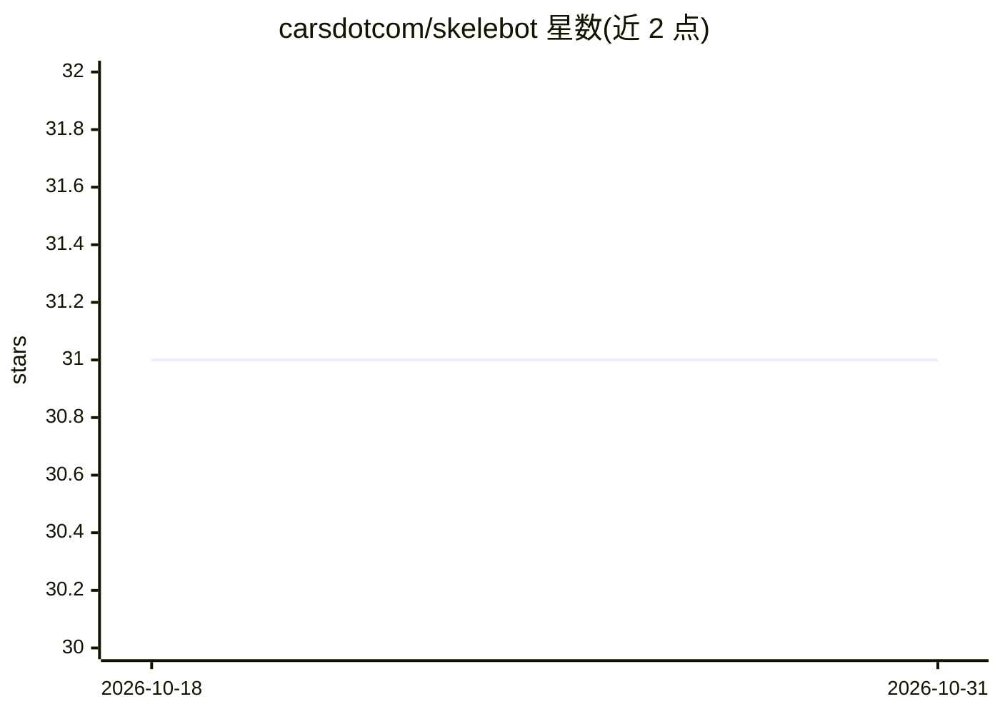

# carsdotcom/skelebot

⭐ 31 · Python · MIT · 推送 2026-10-21 · [GitHub](https://github.com/carsdotcom/skelebot) · [官网](https://carsdotcom.github.io/skelebot/) · 组织维护

**面向数据科学家的机器学习项目命令行开发工具**

Skelebot 是 carsdotcom 维护的 Python 命令行工具，用于开发机器学习项目并在 Docker 中执行，通过统一接口自动处理日常任务（加载数据、训练、评分、jupyter、插件、版本发布等子命令），目的是简化数据科学家的项目流程。以 pip 安装的 PyPI 包形式提供，项目遵循 MIT 许可与语义化版本。

## 筛选速览

| 维度 | 判定 | 备注 |
|---|---|---|
| AI 角色 | `ai-ecosystem` | LLM/agent 周边工具 |
| 许可风险 | `permissive` | MIT |
| 部署形态 | `library` | 以包/库形式分发 |
| 模型依赖 | — | README 未给出锁定关系 |
| 硬件要求 | — | 无带数字的原话,不猜 |
| 安装摩擦 | `low` | 无编译、无系统依赖或容器化 |
| 成熟度 | — | 结构信号不足 |

## 能力要点

- 统一 CLI 管理机器学习项目（loadData/train/score/jupyter 等子命令）
- 项目在 Docker 中执行
- 支持插件（plugin）与多种运行环境（envs）子命令

## 适用场景

- 用统一命令管理数据科学项目的训练与评分流程
- 在 Docker 容器内执行机器学习项目
- 通过插件机制扩展项目工作流

## 场景标签

`MLOps` · 领域:训练与推理

## 证据(README 行号)

> L46: Skelebot is a command-line tool for developing machine learning projects and executing them in Docker. The purpose 

## 星数曲线

2026-10-18 31 → 2026-10-31 31（+0）

---
*卡片 v1 · prompt 1.4 · 生成 2026-10-26 · 置信度 mid · 依据 README sha `42da3fd44412` · [字段定义](../../DATASET.md)*
