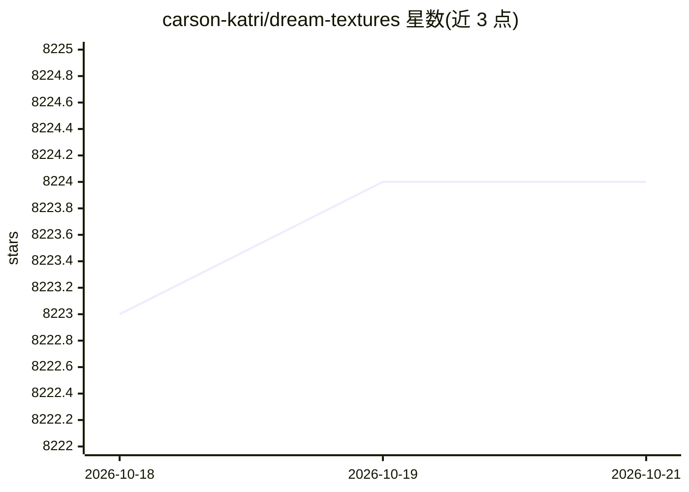

# carson-katri/dream-textures

⭐ 8,224 · Python · GPL-3.0 · 推送 2026-09-17 · [GitHub](https://github.com/carson-katri/dream-textures) · 个人维护

**Blender 内置 Stable Diffusion 插件：文字生成贴图与图像**

一个 Blender 插件，把 Stable Diffusion 图像生成集成进 Blender：通过文字提示生成贴图、概念图与背景素材；提供无缝贴图选项、基于深度图的场景级贴图投影（Project Dream Texture）、Cycles 渲染通道重绘动画、图像修复与外扩（Inpaint/Outpaint）、4 倍 AI 放大，以及节点系统。模型在本地机器上运行，也支持通过 DreamStudio 云端处理。通过下载发布包安装，已在 CUDA 与 Apple Silicon GPU 上测试，建议 4GB 以上显存。

## 筛选速览

| 维度 | 判定 | 备注 |
|---|---|---|
| AI 角色 | `ai-native` | 本体是模型或模型工具 |
| 许可风险 | `viral` | GPL-3.0 |
| 部署形态 | `None` |  |
| 模型依赖 | — | README 未给出锁定关系 |
| 硬件要求 | — | 无带数字的原话,不猜 |
| 安装摩擦 | `medium` | 含编译或系统依赖之一 |
| 成熟度 | — | 结构信号不足 |

## 能力要点

- 文字提示生成贴图、概念图与背景素材
- 深度图驱动的整场景贴图投影与 Cycles 渲染通道重绘动画
- Inpaint/Outpaint、4 倍 AI 放大与历史记录导入导出
- 模型本地运行，硬件不支持时可切换 DreamStudio 云端处理

## 适用场景

- 在 Blender 里直接用文字提示生成无缝贴图
- 用深度图给整个模型或场景投影贴图
- 对现有贴图做修复、外扩或 4 倍放大
- 重绘动画风格

## 场景标签

`图像生成` `图像视频处理` · 领域:内容生成

## 证据(README 行号)

> L7: * Create textures, concept art, background assets, and more with a simple text prompt
> L28: ## Image Generation

## 星数曲线

2026-10-18 8,223 → 2026-10-21 8,224（+1）

---
*卡片 v1 · prompt 1.4 · 生成 2026-10-20 · 置信度 high · 依据 README sha `7b12bfc633ed` · [字段定义](../../DATASET.md)*
