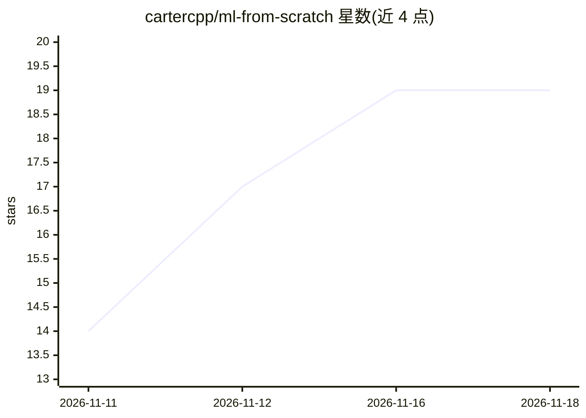

# cartercpp/ml-from-scratch

⭐ 19 · 推送 2026-11-16 · [GitHub](https://github.com/cartercpp/ml-from-scratch) · [官网](https://youtu.be/68MsbnEx7pI?is=-YDftoHjcI_u881I) · 个人维护

**C++ 从零实现的机器学习算法集合索引**

cartercpp 维护的算法清单仓库，收录其以现代 C++（C++20/23，部分 C++26）从零实现、不依赖 PyTorch/Eigen 等 ML 库的机器学习算法项目，各条目链接到独立仓库。覆盖神经网络（反向传播、VAE、GAN、JEPA、RBF 等）、分类、聚类、回归、降维、强化学习、NLP、异常检测、进化算法及比特币价格预测等应用。README 仅作索引，不含安装说明，构建要求见各子仓库。

## 筛选速览

| 维度 | 判定 | 备注 |
|---|---|---|
| AI 角色 | `ai-knowledge` | 知识聚合/清单类 |
| 许可风险 | `none` | — |
| 部署形态 | `None` |  |
| 模型依赖 | — | README 未给出锁定关系 |
| 硬件要求 | — | 无带数字的原话,不猜 |
| 安装摩擦 | `low` | 无编译、无系统依赖或容器化 |
| 成熟度 | — | 结构信号不足 |

## 能力要点

- 全部实现仅用 C++ 标准库，无 PyTorch/Eigen 等外部 ML 库
- 覆盖神经网络、聚类、回归、强化学习、进化算法等 10+ 类算法
- 每条目链接到 github.com/cartercpp 下的独立仓库

## 适用场景

- 查阅各算法的纯 C++ 参考实现
- 学习算法底层原理的代码级材料
- 按类别浏览可复用的独立 C++ 算法项目

## 场景标签

`精选清单` · 领域:学习与行业

## 证据(README 行号)

> L1: # From-Scratch Machine Learning Algorithms
> L3: A collection of machine learning algorithms implemented from scratch in modern C++ without external ML libraries.
> L5: Each link goes to its own repository under github.com/cartercpp.

## 星数曲线

2026-11-11 14 → 2026-11-18 19（+5）

---
*卡片 v1 · prompt 1.4 · 生成 2026-11-18 · 置信度 high · 依据 README sha `99b5c8b5359c` · [字段定义](../../DATASET.md)*
