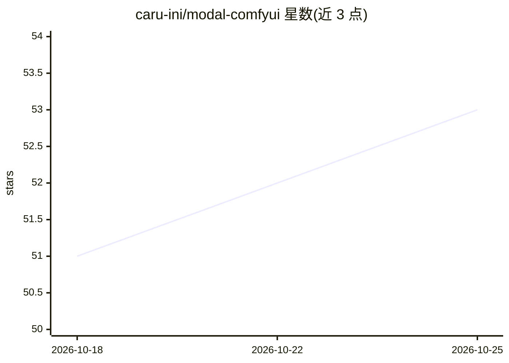

# caru-ini/modal-comfyui

⭐ 53 · Python · 推送 2026-10-05 · [GitHub](https://github.com/caru-ini/modal-comfyui) · 个人维护

**在 Modal 云上部署 ComfyUI 的脚手架：自动扩缩容与模型管理**

将 ComfyUI 部署到 Modal 无服务器 GPU 平台的配置工程：通过 models.py 管理 Hugging Face 与外部（如 civitai）模型，下载至 Modal Volumes 并符号链接到 ComfyUI 模型目录；支持自动扩缩容（闲时缩容到零）、GPU 快照加速启动、基于 comfy-cli 的自定义节点安装，以及从 workflow_api.json 自动安装工作流依赖。面向需要在云端运行图像/视频生成工作流的开发者，使用需 Modal 账号与 Python/uv 环境。

## 筛选速览

| 维度 | 判定 | 备注 |
|---|---|---|
| AI 角色 | `ai-ecosystem` | LLM/agent 周边工具 |
| 许可风险 | `none` | — |
| 部署形态 | `None` |  |
| 模型依赖 | — | README 未给出锁定关系 |
| 硬件要求 | — | 无带数字的原话,不猜 |
| 安装摩擦 | `low` | 无编译、无系统依赖或容器化 |
| 成熟度 | — | 结构信号不足 |

## 能力要点

- 自动扩缩容，空闲时缩容到零以节省成本
- Modal GPU 快照缩短启动时间
- 通过 models.py 配置 Hugging Face / 外部 URL 模型并缓存到 Volumes
- comfy-cli 集成安装自定义节点，workflow_api.json 可触发依赖自动安装

## 适用场景

- 不想本地配 GPU，在云端跑 ComfyUI 图像/视频生成工作流
- 测试 wan2.2 等视频生成模型
- 按需伸缩地托管生产用 ComfyUI 应用

## 场景标签

`图像生成` `视频生成` `推理引擎` · 领域:内容生成

## 证据(README 行号)

> L3: Run ComfyUI on Modal with auto-scaling, GPU snapshots, and easy model management.
> L60: Run the following command to start ComfyUI in development mode:
> L75: - **Auto-scaling**: Scales down to zero when not in use to save costs.

## 星数曲线

2026-10-18 51 → 2026-10-25 53（+2）

---
*卡片 v1 · prompt 1.4 · 生成 2026-10-24 · 置信度 high · 依据 README sha `e6dae870014c` · [字段定义](../../DATASET.md)*
