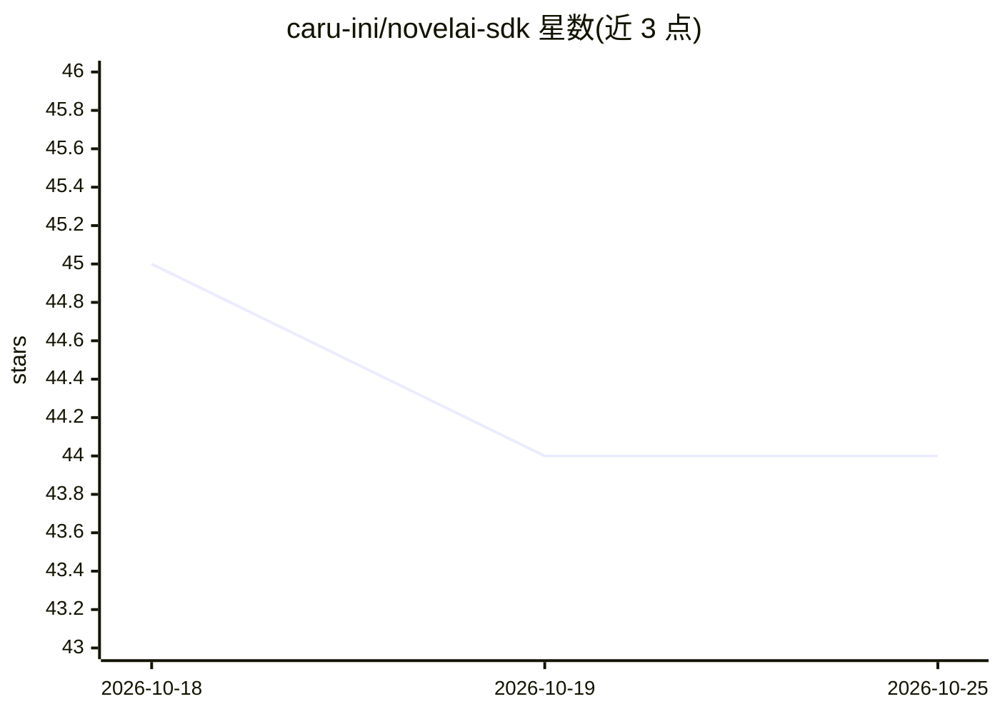

# caru-ini/novelai-sdk

⭐ 44 · Python · MIT · 推送 2026-10-22 · [GitHub](https://github.com/caru-ini/novelai-sdk) · [官网](https://caru-ini.github.io/novelai-sdk/) · 个人维护 · 中文 README

**NovelAI 图像生成 API 的类型安全 Python SDK**

面向开发者的 NovelAI 官方 API 非官方 Python 客户端库：封装图像生成（支持 nai-diffusion-4.5/5 系列模型）、角色参考、ControlNet/Vibe Transfer、多角色定位、Director Tools（线稿/上色/去背景/2x 放大等）、SSE 流式进度、图生图、批量生成与 Anlas 费用预估；提供高级 API 与 1:1 映射 API 两层数据模型、Pydantic v2 校验、CLI 与内建 Pillow 支持。文本生成列为规划中。需有效的 NovelAI 订阅与 API key。

## 筛选速览

| 维度 | 判定 | 备注 |
|---|---|---|
| AI 角色 | `ai-ecosystem` | LLM/agent 周边工具 |
| 许可风险 | `permissive` | MIT |
| 部署形态 | `library` | 以包/库形式分发 |
| 模型依赖 | — | README 未给出锁定关系 |
| 硬件要求 | — | 无带数字的原话,不猜 |
| 安装摩擦 | `low` | 无编译、无系统依赖或容器化 |
| 成熟度 | — | 结构信号不足 |

## 能力要点

- Pydantic v2 校验与完整类型提示（Python 3.10+）
- 角色参考、ControlNet、多角色定位与 Director Tools
- SSE 流式进度监控与图生图、批量生成
- CLI 入口（python -m novelai）与标签建议（en/jp）

## 适用场景

- 在自己的 Python 程序中调用 NovelAI 生成图像
- 用参考图保持角色外观一致或控制构图姿态
- 批量生成变体并通过 Anlas 预估控制费用

## 场景标签

`图像生成` · 领域:内容生成

## 证据(README 行号)

> L12: A modern, type-safe Python SDK for NovelAI's image generation API. Features robust validation with Pydantic v2 and 
> L243: This is an unofficial client library. Not affiliated with NovelAI. Requires an active NovelAI subscription.

## 星数曲线

2026-10-18 45 → 2026-10-25 44（-1）

---
*卡片 v1 · prompt 1.4 · 生成 2026-10-25 · 置信度 high · 依据 README sha `195f002ca9bd` · [字段定义](../../DATASET.md)*
