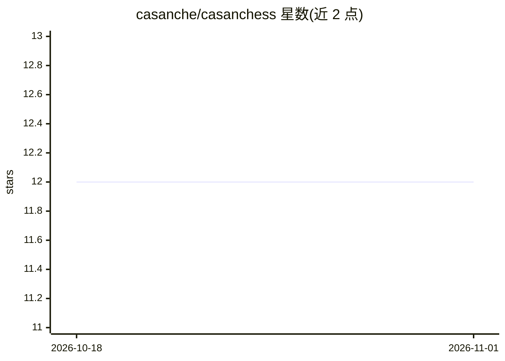

# casanche/casanchess

⭐ 12 · C++ · MIT · 推送 2026-10-30 · [GitHub](https://github.com/casanche/casanchess) · 个人维护

**C++23 编写的 UCI 国际象棋引擎，采用 NNUE 评估**

Casanchess 是一个用 C++23 实现的 UCI 象棋（国际象棋）引擎，核心为 NNUE 评估，其网络基于自走棋与随机局面的数百万样本训练，配套自制数据生成与训练器。设计目标是兼顾棋力与可读性，改进通过严格 SPRT 测试迭代推进。提供 Releases 页预编译二进制（需 AVX2 CPU），也可用 CMake 自行编译；附带非标准 UCI 选项 Ambition 可调整求胜倾向。可在 Lichess 上对弈。

## 筛选速览

| 维度 | 判定 | 备注 |
|---|---|---|
| AI 角色 | `ai-native` | 本体是模型或模型工具 |
| 许可风险 | `permissive` | MIT |
| 部署形态 | `None` |  |
| 模型依赖 | — | README 未给出锁定关系 |
| 硬件要求 | — | 无带数字的原话,不猜 |
| 安装摩擦 | `medium` | 含编译或系统依赖之一 |
| 成熟度 | — | 结构信号不足 |

## 能力要点

- NNUE 评估基于数百万自走棋与随机局面训练
- 支持非标准 UCI 选项 Ambition（基于专用 NNUE 输出头调整求胜倾向）
- 提供预编译发布二进制与 CMake 源码编译两种途径

## 适用场景

- 通过 UCI 界面或 Lichess 与引擎对弈
- 学习现代国际象棋引擎编程（含 NNUE 实现）
- 作为基准对手测试其他象棋引擎

## 场景标签

 · 领域:博弈/棋类引擎

## 证据(README 行号)

> L6: **UCI chess engine written in C++23 with NNUE evaluation**
> L14: Its NNUE evaluation is trained on millions of self-play and random positions, using a custom datagen and trainer.

## 星数曲线

2026-10-18 12 → 2026-11-01 12（+0）

---
*卡片 v1 · prompt 1.4 · 生成 2026-11-01 · 置信度 high · 依据 README sha `da48064ec394` · [字段定义](../../DATASET.md)*
