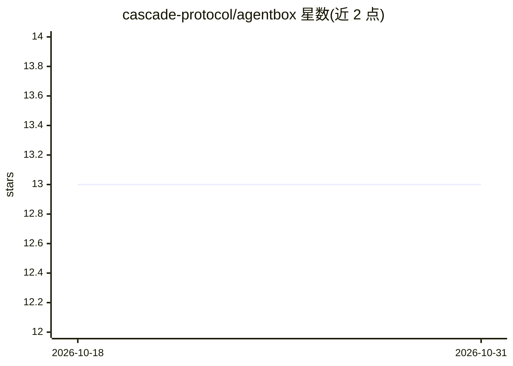

# cascade-protocol/agentbox

⭐ 13 · TypeScript · Apache-2.0 · 推送 2026-03-24 · [GitHub](https://github.com/cascade-protocol/agentbox) · [官网](https://agentbox.fyi) · 组织维护

**供给并管理 OpenClaw VM 实例的运维面板与后端**

面向运营者的仪表盘与后端：在 Hetzner Cloud 上供给并管理基于 OpenClaw 的 VM 实例。技术栈为 pnpm monorepo + Turborepo，后端 Hono/Node.js/Drizzle/PostgreSQL，前端 Vite/React 19；含 x402 支付与 pump.fun 交易的 OpenClaw 插件、golden image 构建脚本与 Docker compose 本地编排。通过 git clone 与 pnpm 命令运行，需要配置 Hetzner API token、数据库连接等环境变量。

## 筛选速览

| 维度 | 判定 | 备注 |
|---|---|---|
| AI 角色 | `ai-ecosystem` | LLM/agent 周边工具 |
| 许可风险 | `permissive` | Apache-2.0 |
| 部署形态 | `self-host` | docker 或自建部署 |
| 模型依赖 | — | README 未给出锁定关系 |
| 硬件要求 | — | 无带数字的原话,不猜 |
| 安装摩擦 | `low` | 无编译、无系统依赖或容器化 |
| 成熟度 | — | 结构信号不足 |

## 能力要点

- 在 Hetzner Cloud 上供给并管理 OpenClaw VM 实例
- OpenClaw 插件支持 x402 支付与 pump.fun 交易
- 提供 golden image 构建与 Docker compose 编排
- 包含 API 服务器、认证、回调处理与仪表盘 UI

## 适用场景

- 运营者批量创建和管理 OpenClaw agent VM 实例
- 通过仪表盘监控供给流程与回调处理
- 为 OpenClaw agent 接入 x402 支付与链上交易

## 场景标签

 · 领域:AI agent 基础设施/云运维

## 证据(README 行号)

> L3: AgentBox is an operator dashboard and backend for provisioning and managing OpenClaw-based VM instances.
> L16: - `packages/openclaw-x402` - OpenClaw plugin for x402 payments and pump.fun trading

## 星数曲线

2026-10-18 13 → 2026-10-31 13（+0）

---
*卡片 v1 · prompt 1.4 · 生成 2026-10-31 · 置信度 mid · 依据 README sha `79682376ce17` · [字段定义](../../DATASET.md)*
