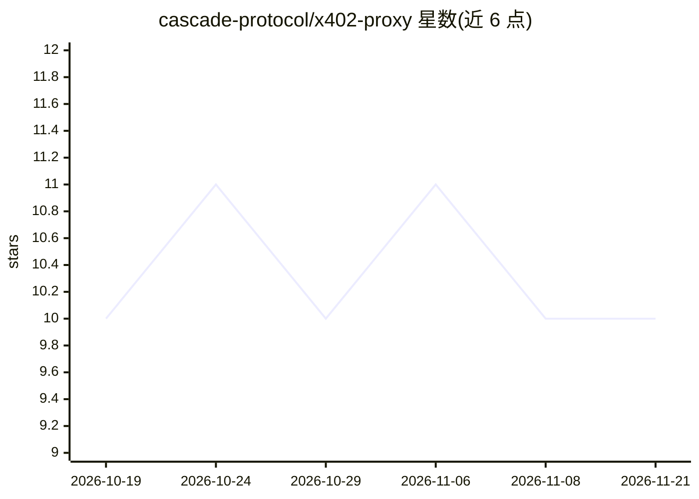

# cascade-protocol/x402-proxy

⭐ 10 · TypeScript · Apache-2.0 · 推送 2026-08-14 · [GitHub](https://github.com/cascade-protocol/x402-proxy) · [官网](https://www.npmjs.com/package/x402-proxy) · 组织维护

**供 AI 代理与开发者自动支付付费 API 的 CLI/MCP 代理**

以 curl 风格访问 x402 与 MPP 付费 API：收到 HTTP 402 后自动完成支付并流式返回响应体，支付信息输出到 stderr。单个 BIP-39 助记词同时派生 EVM（Base/Monad/Tempo）与 Solana 两链密钥，买方侧无需编写加密货币代码。可作为 CLI、面向 AI 代理的 MCP 代理（自动检测 Claude Code、Cursor 等 16+ 客户端并写入配置）或 Node.js 库使用；另提供 OpenClaw 插件（独立 npm 包）为网关注册 x402/MPP 支付能力。Apache-2.0 许可，经 npx 使用。

## 筛选速览

| 维度 | 判定 | 备注 |
|---|---|---|
| AI 角色 | `ai-ecosystem` | LLM/agent 周边工具 |
| 许可风险 | `permissive` | Apache-2.0 |
| 部署形态 | `library` | 以包/库形式分发 |
| 模型依赖 | — | README 未给出锁定关系 |
| 硬件要求 | — | 无带数字的原话,不猜 |
| 安装摩擦 | `low` | 无编译、无系统依赖或容器化 |
| 成熟度 | — | 结构信号不足 |

## 能力要点

- 对返回 402 的端点自动支付并流式输出响应
- 单助记词派生 EVM 与 Solana 两链密钥，买方零加密代码
- MCP 代理自动检测已安装 AI 客户端并写入配置
- 支持一次性支付（x402/MPP charge）与按 token 流式计费（MPP sessions）

## 适用场景

- 让 AI 代理按调用付费地消费付费 MCP 服务器
- 像 curl 一样从命令行请求付费 API
- 通过本地付费代理运行 Claude Code 等推理客户端

## 场景标签

 · 领域:Agent 支付/付费 API 访问基础设施

## 证据(README 行号)

> L7: curl for x402 and MPP paid APIs with MCP proxy support. Auto-pays HTTP 402 on Base, Monad, Solana, and Tempo.
> L9: Zero crypto code on the buyer side. One mnemonic derives both EVM (Base/Monad/Tempo) and Solana keypairs - fund any 
> L47: Let your AI agent consume any paid MCP server.

## 星数曲线

2026-10-19 10 → 2026-11-21 10（+0）

---
*卡片 v1 · prompt 1.4 · 生成 2026-11-19 · 置信度 high · 依据 README sha `56be93173df4` · [字段定义](../../DATASET.md)*
