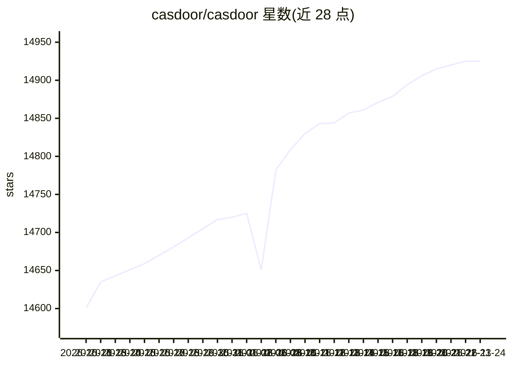

# casdoor/casdoor

⭐ 14,925 · Go · Apache-2.0 · 推送 2026-11-22 · [GitHub](https://github.com/casdoor/casdoor) · [官网](https://casdoor.ai) · 组织维护

**开源自托管 IAM/SSO 认证服务器，提供 MCP 网关与 agent 访问控制**

Casdoor 是一个自托管的身份与访问管理平台：存储用户目录、签发令牌，并通过 Web 控制台管理组织、应用与提供方。同一用户目录可通过 OAuth 2.0、OIDC、SAML 2.0、CAS、LDAP、SCIM 2.0、WebAuthn、TOTP/MFA 与 MCP 等协议访问，支持对接 Google Workspace、Entra ID、GitHub 等身份源。AI 相关能力为 MCP 网关（对 MCP 服务器做访问控制）与 A2A agent 通信支持，属于整个认证服务器中的功能模块。部署方式含 Docker、Docker Compose、Helm 与源码构建，另提供托管版 Casdoor Cloud 与在线演示。

## 筛选速览

| 维度 | 判定 | 备注 |
|---|---|---|
| AI 角色 | `ai-enhanced` | 去掉 AI 部分产品仍成立 |
| 许可风险 | `permissive` | Apache-2.0 |
| 部署形态 | `self-host` | docker 或自建部署 |
| 模型依赖 | — | README 未给出锁定关系 |
| 硬件要求 | — | 无带数字的原话,不猜 |
| 安装摩擦 | `low` | 无编译、无系统依赖或容器化 |
| 成熟度 | — | 结构信号不足 |

## 动量与使用信号

- 维护:`active` — 距上次 push 0.8 天,年发版 100,313 位贡献者
- 涨星:近 1 天 **+11**(自 20261016 起算)
- 下载:GitHub Release 附件 累计 6,622(100 个 release)
- 平台:— · 协议:MCP

## 能力要点

- 单服务器支持 OAuth 2.0/OIDC/SAML 2.0/CAS/LDAP/SCIM 2.0/WebAuthn/TOTP-MFA 多协议
- MCP 网关：暴露 Model Context Protocol 服务器并控制访问，支持 A2A agent 通信
- 内置 Casbin 策略授权（ACL/RBAC/ABAC），多组织多租户与审计日志
- Marketplace 提供 Grafana、GitLab、Nextcloud、Open WebUI 等应用的现成集成

## 适用场景

- 为企业多个新旧应用统一接入单点登录
- 为组织托管自有用户目录并管理 RBAC 权限
- 对 MCP 服务器与 agent 间通信做身份认证与访问控制
- 对接 Google、GitHub、Entra ID 等外部身份提供方

## 场景标签

 · 领域:身份认证/IAM 基础设施

## 证据(README 行号)

> L7:  Casdoor is a single sign-on (SSO) and authentication server with a web console.
> L225: - **MCP gateway** — expose Model Context Protocol servers and control access to them
> L226: - **A2A** — agent-to-agent communication support

## 星数曲线

2026-10-21 14,601 → 2026-11-24 14,925（+324）

---
*卡片 v1 · prompt 1.4 · 生成 2026-11-22 · 置信度 high · 依据 README sha `3d453926c09b` · [字段定义](../../DATASET.md)*
