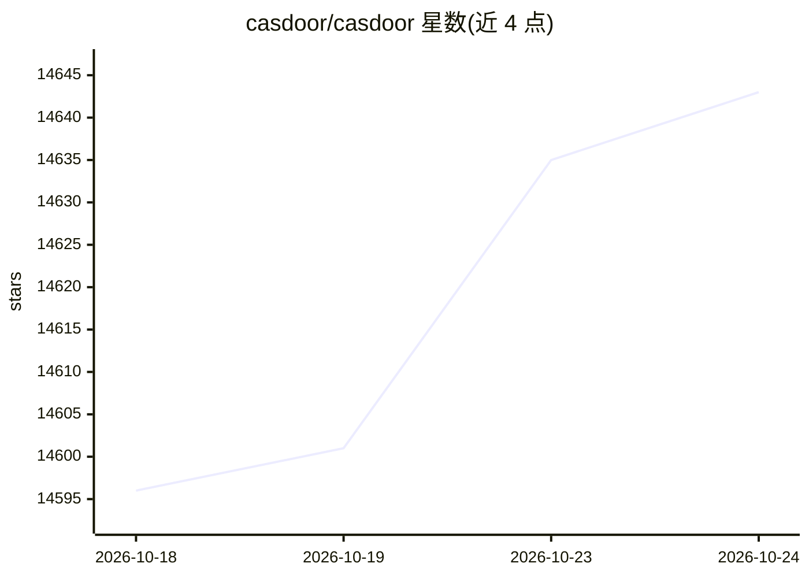

# casdoor/casdoor

⭐ 14,643 · Go · Apache-2.0 · 推送 2026-10-23 · [GitHub](https://github.com/casdoor/casdoor) · [官网](https://casdoor.ai) · 组织维护

**为应用与 AI agent 提供自托管 SSO/IAM 的认证服务器**

自托管的单点登录与身份认证服务器，带 Web 管理控制台。支持 OAuth 2.0、OIDC、SAML 2.0、CAS、LDAP、SCIM 2.0、WebAuthn、TOTP/MFA、Face ID 等协议，并可对接 Google Workspace、Entra ID、GitHub 等身份提供方。组织、应用、登录方式等均在控制台配置，无需改动配置文件重新部署；授权策略基于 Casbin（ACL/RBAC/ABAC）。AI 相关部分包括 MCP 网关与 A2A 通信支持。提供 Docker、Docker Compose、Helm、源码四种安装路径及商业托管版 Casdoor Cloud。

## 筛选速览

| 维度 | 判定 | 备注 |
|---|---|---|
| AI 角色 | `ai-ecosystem` | LLM/agent 周边工具 |
| 许可风险 | `permissive` | Apache-2.0 |
| 部署形态 | `self-host` | docker 或自建部署 |
| 模型依赖 | — | README 未给出锁定关系 |
| 硬件要求 | — | 无带数字的原话,不猜 |
| 安装摩擦 | `low` | 无编译、无系统依赖或容器化 |
| 成熟度 | — | 结构信号不足 |

## 动量与使用信号

- 维护:`active` — 距上次 push 0.8 天,年发版 100,313 位贡献者
- 涨星:近 1 天 **+11**(自 20261016 起算)
- 下载:GitHub Release 附件 累计 6,622(100 个 release)
- 平台:— · 协议:MCP

## 能力要点

- 多协议认证：OAuth 2.0/OIDC、SAML 2.0、CAS、LDAP、SCIM 2.0、WebAuthn、TOTP/MFA、Face ID
- MCP 网关：暴露 Model Context Protocol 服务器并控制访问，另支持 A2A 通信
- Casbin 策略授权（ACL/RBAC/ABAC）与多租户组织管理
- 四种安装路径：Docker all-in-one、Docker Compose+MySQL、Helm、源码构建

## 适用场景

- 为多个新旧应用统一接入单点登录
- 为 AI agent 的 MCP 服务器做访问控制
- 企业内对接 Google/GitHub/Entra ID 等登录方式
- 以 Git 文件或 Terraform 管理组织、用户与权限配置

## 场景标签

 · 领域:身份认证与访问管理

## 证据(README 行号)

> L7:  Casdoor is a single sign-on (SSO) and authentication server with a web console.
> L225: - **MCP gateway** — expose Model Context Protocol servers and control access to them
> L226: - **A2A** — agent-to-agent communication support

## 星数曲线

2026-10-18 14,596 → 2026-10-24 14,643（+47）

---
*卡片 v1 · prompt 1.4 · 生成 2026-10-18 · 置信度 high · 依据 README sha `6493008e6f17` · [字段定义](../../DATASET.md)*
