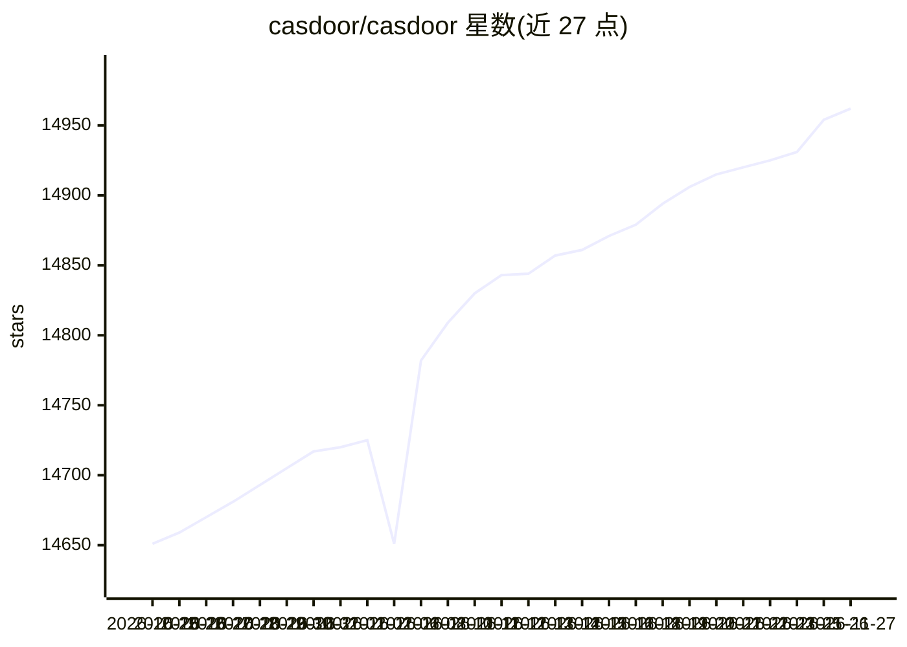

# casdoor/casdoor

⭐ 14,962 · Go · Apache-2.0 · 推送 2026-11-26 · [GitHub](https://github.com/casdoor/casdoor) · [官网](https://casdoor.ai) · 组织维护

**开源自托管 IAM/SSO 认证服务器，兼作 LLM MCP 网关**

自托管的身份与访问管理平台：单点登录认证服务器，支持 OAuth 2.0、OIDC、SAML 2.0、CAS、LDAP、SCIM 2.0、WebAuthn、TOTP/MFA 等协议，可对接 Google Workspace、Azure AD、GitHub 等身份提供方。通过 Web 控制台管理用户、组织、应用与权限策略（Casbin ACL/RBAC/ABAC），提供多语言 SDK 与 REST API。AI 相关部分：MCP 网关控制对 Model Context Protocol 服务器的访问，以及 A2A agent 间通信支持。

## 筛选速览

| 维度 | 判定 | 备注 |
|---|---|---|
| AI 角色 | `ai-enhanced` | 去掉 AI 部分产品仍成立 |
| 许可风险 | `permissive` | Apache-2.0 |
| 部署形态 | `self-host` | docker 或自建部署 |
| 模型依赖 | — | README 未给出锁定关系 |
| 硬件要求 | — | 无带数字的原话,不猜 |
| 安装摩擦 | `low` | 无编译、无系统依赖或容器化 |
| 成熟度 | — | 结构信号不足 |

## 动量与使用信号

- 维护:`active` — 距上次 push 0.8 天,年发版 100,313 位贡献者
- 涨星:近 1 天 **+11**(自 20261016 起算)
- 下载:GitHub Release 附件 累计 6,622(100 个 release)
- 平台:— · 协议:MCP

## 能力要点

- 单服务器支持 OAuth 2.0/OIDC、SAML 2.0、CAS、LDAP、SCIM 2.0 多协议
- Web 控制台内配置组织、应用、登录方式与品牌，Casbin 策略授权
- MCP 网关：暴露 Model Context Protocol 服务器并控制访问；支持 A2A 通信
- 提供 Go/Java/Python/Node.js/.NET/PHP/Rust 等 SDK 与 REST API

## 适用场景

- 为多个应用统一提供单点登录与用户目录管理
- 接入 Google、GitHub、Entra ID 等第三方登录
- 为 MCP 服务器和 agent 提供访问控制与认证
- 对 Grafana、GitLab 等应用一键配置 SSO 集成

## 场景标签

 · 领域:身份与访问管理/认证基础设施

## 证据(README 行号)

> L5:  An open-source, self-hosted identity and access management platform
> L7:  Casdoor is a single sign-on (SSO) and authentication server with a web console.
> L225: - **MCP gateway** — expose Model Context Protocol servers and control access to them

## 星数曲线

2026-10-25 14,651 → 2026-11-27 14,962（+311）

---
*卡片 v1 · prompt 1.4 · 生成 2026-11-27 · 置信度 high · 依据 README sha `d7e2915241f7` · [字段定义](../../DATASET.md)*
