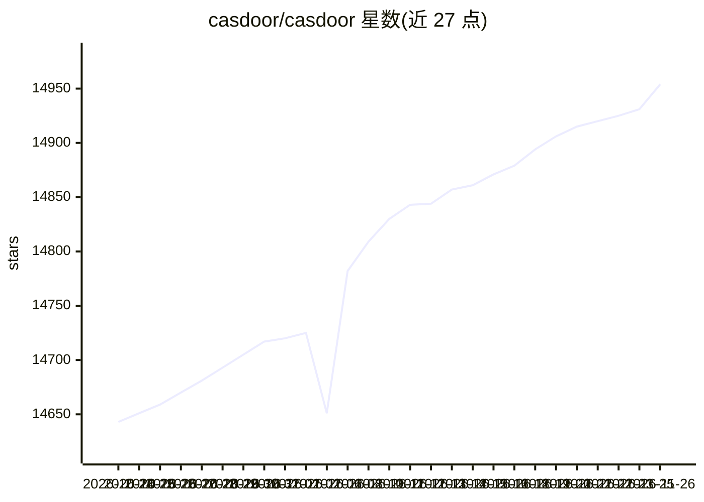

# casdoor/casdoor

⭐ 14,954 · Go · Apache-2.0 · 推送 2026-11-25 · [GitHub](https://github.com/casdoor/casdoor) · [官网](https://casdoor.ai) · 组织维护

**开源自托管 IAM/SSO 认证服务器，含 MCP 网关与 Web 控制台**

自托管的单一登录与身份认证服务器，提供 Web 管理控制台；支持 OAuth 2.0、OIDC、SAML 2.0、CAS、LDAP、SCIM 2.0、WebAuthn、TOTP/MFA、Face ID 等协议与登录方式，并可连接 Google Workspace、Entra ID、GitHub 等身份提供方。用户、组织、应用与权限在控制台中配置而非配置文件，授权通过 Casbin 策略（ACL/RBAC/ABAC）表达。AI 相关功能为 MCP 网关（暴露并控制 Model Context Protocol 服务器访问）与 A2A 代理间通信支持。以 Go 单二进制加数据库方式运行，支持 MySQL/PostgreSQL/SQLite/SQL Server。

## 筛选速览

| 维度 | 判定 | 备注 |
|---|---|---|
| AI 角色 | `ai-enhanced` | 去掉 AI 部分产品仍成立 |
| 许可风险 | `permissive` | Apache-2.0 |
| 部署形态 | `self-host` | docker 或自建部署 |
| 模型依赖 | — | README 未给出锁定关系 |
| 硬件要求 | — | 无带数字的原话,不猜 |
| 安装摩擦 | `low` | 无编译、无系统依赖或容器化 |
| 成熟度 | — | 结构信号不足 |

## 动量与使用信号

- 维护:`active` — 距上次 push 0.8 天,年发版 100,313 位贡献者
- 涨星:近 1 天 **+11**(自 20261016 起算)
- 下载:GitHub Release 附件 累计 6,622(100 个 release)
- 平台:— · 协议:MCP

## 能力要点

- 同一用户目录可通过 OAuth/OIDC/SAML/CAS/LDAP/SCIM 多协议访问
- MCP 网关：暴露 Model Context Protocol 服务器并控制访问
- Web 控制台配置组织、应用、提供方与品牌，无需重部署
- Marketplace 一键安装 Grafana、GitLab、Nextcloud 等应用集成

## 适用场景

- 为企业多个新旧应用统一接入单点登录
- 管理多组织用户的身份与 RBAC 权限
- 为 MCP 服务器提供访问控制网关
- 通过 SCIM 自动化用户开通与注销

## 场景标签

 · 领域:身份与访问管理/基础设施

## 证据(README 行号)

> L5:  An open-source, self-hosted identity and access management platform
> L225: - **MCP gateway** — expose Model Context Protocol servers and control access to them
> L226: - **A2A** — agent-to-agent communication support

## 星数曲线

2026-10-24 14,643 → 2026-11-26 14,954（+311）

---
*卡片 v1 · prompt 1.4 · 生成 2026-11-26 · 置信度 high · 依据 README sha `b0291a3cc4d2` · [字段定义](../../DATASET.md)*
